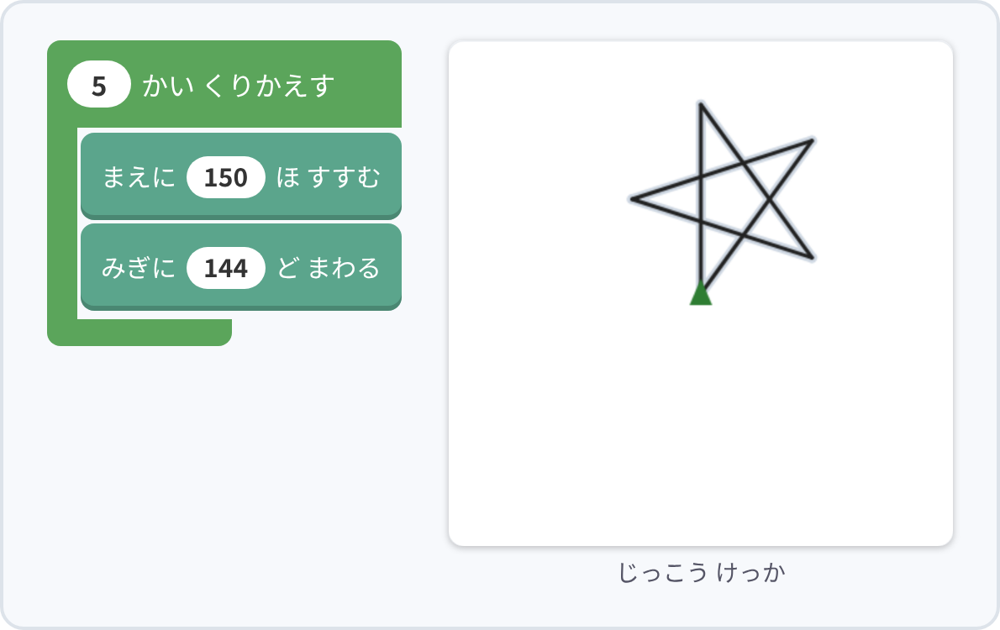
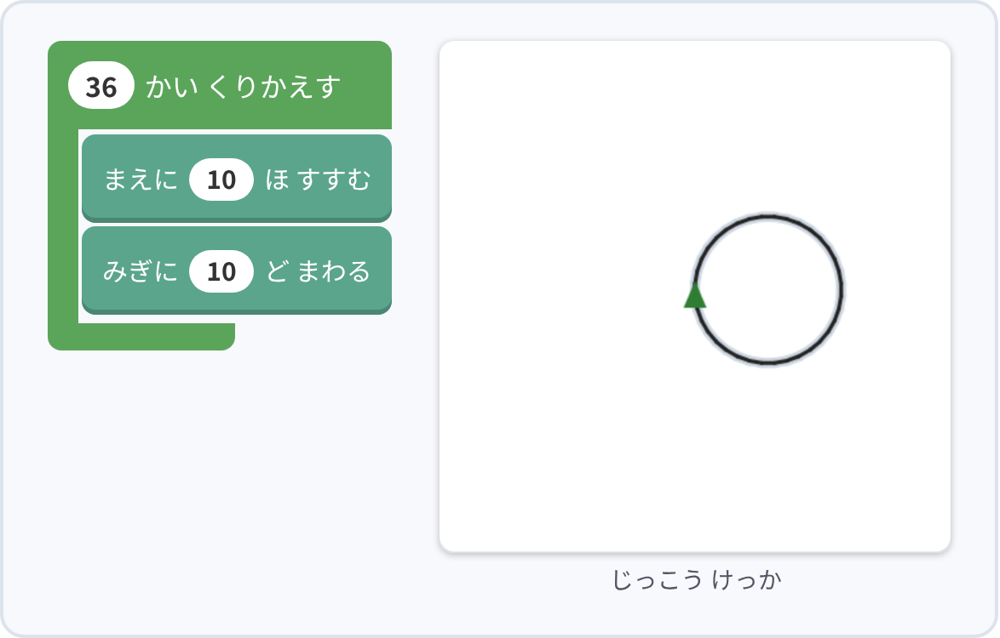
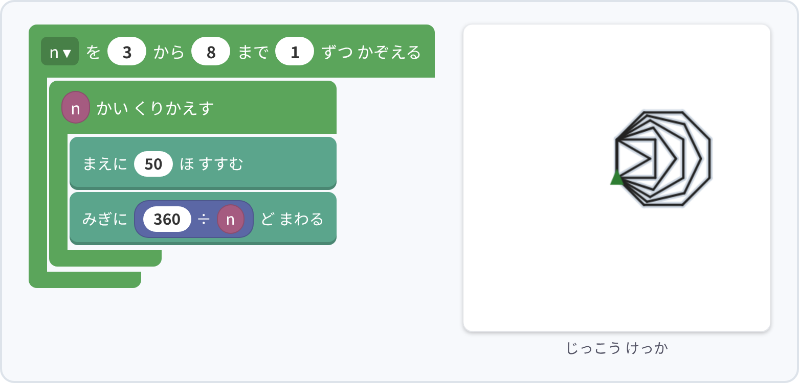
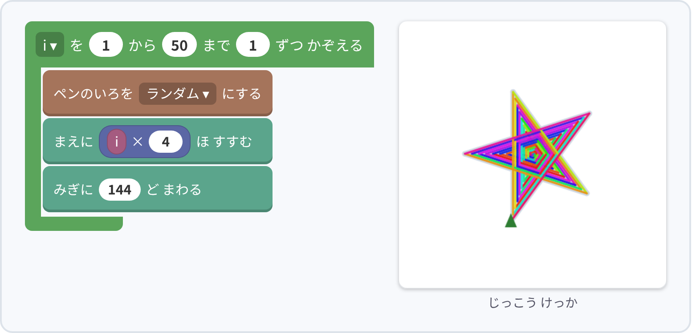
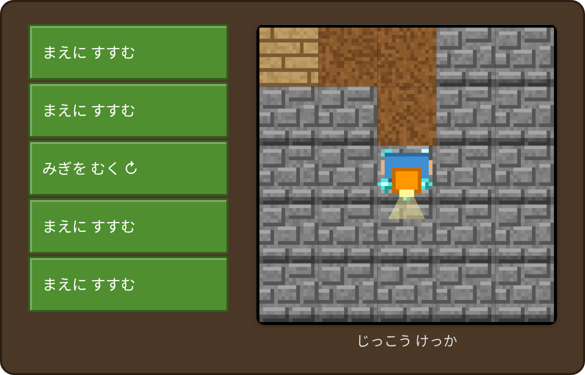
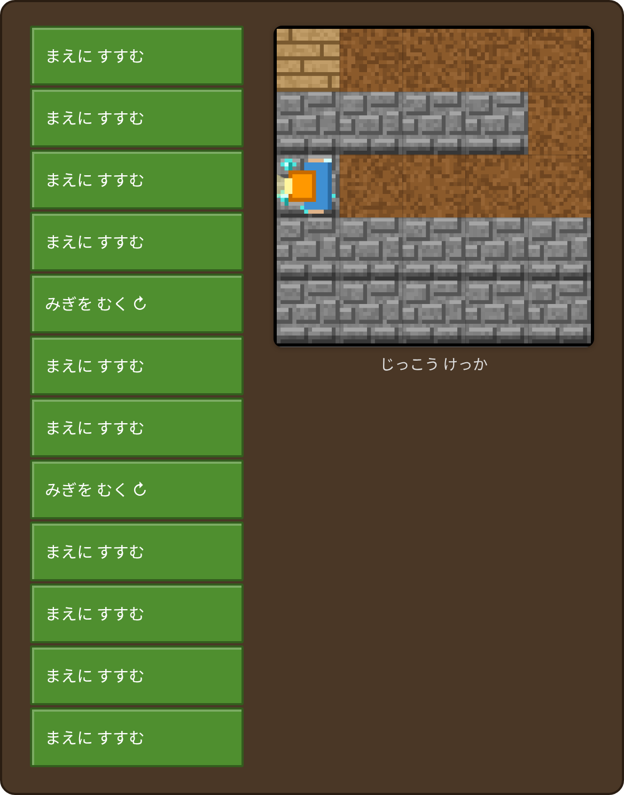
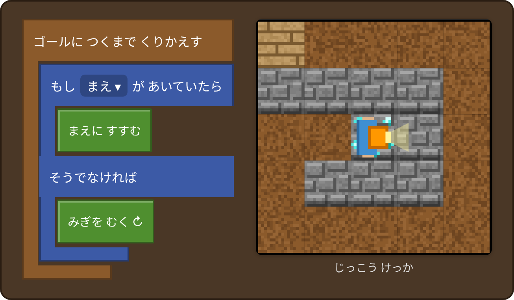
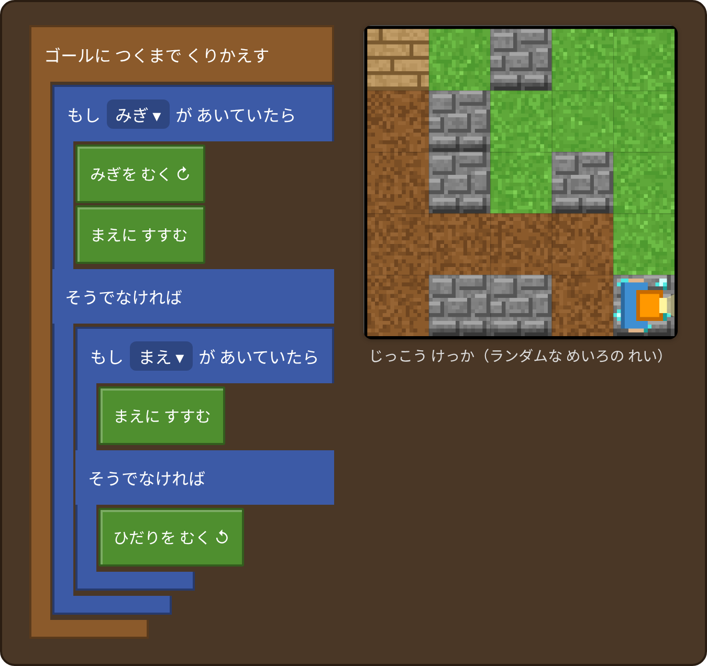

# こたえ（先生・保護者向け）

このファイルには、2つのアプリの解答をまとめています。
どの解答も、左が組むブロック、右が実行した結果の画像です。

- 🐢 **ブロックでおえかき**（index.html）：おだい ①〜⑨
- ⛏ **ブロックでめいろ**（maze.html）：ステージ 1〜8

## 📖 先生モード（こたえをブロックで読み込む）

URL の最後に `?sensei` を付けて開くと、ヘッダーに「📖 こたえ」ボタンが出ます。

```
https://<ユーザー名>.github.io/<リポジトリ名>/index.html?sensei
https://<ユーザー名>.github.io/<リポジトリ名>/maze.html?sensei
```

ボタンを押すと、選んでいるおだい（ステージ）の解答ブロックが読み込まれます。「▶ じっこう」で動きを確かめられるので、授業での解説に使えます。
読み込むと、そのおだい（ステージ）で組んでいたブロックは解答に置きかわります。

---

# 🐢 ブロックでおえかき

アプリの「おだい」を選ぶと、お手本がうすい灰色で表示されます。
「▶ じっこう」でかき終わると、お手本と線の位置をくらべて自動で判定します。
判定するのは線の形と位置だけです。色や太さは自由に変えてかまいません。
カメはまんなかから上を向いてスタートします。

| # | おだい | 学べること |
|---|---|---|
| ① | 六角形 | くりかえし、外角 = 360 ÷ 角の数 |
| ② | ほし | 2周（720°）まわる図形 |
| ③ | まる | 小さな直線で円を近似する |
| ④ | まど | 入れ子のくりかえし |
| ⑤ | はな | 入れ子のくりかえし + 回転対称 |
| ⑥ | しかくいうずまき | 変数（カウンター）を長さに使う |
| ⑦ | ならんだ多角形 | 変数 + 計算ブロック（360 ÷ n） |
| ⑧ | ゆきのけっしょう | 手順の分解、「もとの場所にもどる」考え方 |
| ⑨ | ほしのうずまき | 変数 × 計算 + 回転 |

---

### ① 六角形 ★


### ② ほし ★★

5回で2周（720°）するので、1回あたり 720 ÷ 5 = 144° まわります。

### ③ まる ★★


### ④ まど ★★★


### ⑤ はな ★★★


### ⑥ しかくい うずまき ★★★★


### ⑦ ならんだ たかくけい ★★★★

変数 n は「へんすう」カテゴリの「へんすうを作る」で作ります。

### ⑧ ゆきの けっしょう ★★★★★

1本の枝をかいたら、向きも位置も元にもどすのがポイントです。

### ⑨ ほしの うずまき ★★★★★

ループの中に「ペンのいろを ランダム にする」を入れると、カラフルになります。

---

### おだいを増やすには

`index.html` の `CHALLENGES` に1つ追加します。

```js
{ title: '⑩ ○○ ★★★',
  text: '子どもに見せる説明',
  hint: 'ヒント',
  answer: 'for(let k=0;k<3;k++){forward(100);turn(120);}' }
```

`answer` にはお手本をかくプログラムを書きます。使える命令は次のとおりです。

- `forward(ほ)`：マイナスの値で後ろにさがる
- `turn(ど)`：マイナスの値で左にまわる
- `pen(true/false)`：ペンをおろす／あげる
- `home()`：まんなかにもどる

解答ブロックを付けるときは、`ANSWER_BLOCKS` にも同じ順番で追加します。

---

# ⛏ ブロックでめいろ

たんけんか（キャラクター）は、ヘルメットのライトが照らしている方向が「まえ」です。
ステージ4〜7の「めやす」は、使うブロックの数です（数字の入力欄は数えません）。

| ステージ | 学べること | 解答のブロック数 |
|---|---|---|
| 1 まっすぐ すすもう | 順番に並べる（順次） | 4 |
| 2 まがってみよう | 向きの考え方 | 5 |
| 3 ながい みち | 長い手順を組み立てる | 12 |
| 4 くりかえしを つかおう | くりかえし | 5（めやす 5） |
| 5 かいだんを のぼろう | パターンを見つける | 5（めやす 5） |
| 6 もし〜なら | 条件分岐、条件つきのくりかえし | 4（めやす 4） |
| 7 みぎ？ ひだり？ | 条件分岐の入れ子 | 6（めやす 6） |
| 8 どんな めいろでも | 一般化（アルゴリズム） | 7 |

### ステージ1　まっすぐ すすもう


### ステージ2　まがってみよう

「むく」ではマスを動かず、向きだけが変わります。

### ステージ3　ながい みち

ブロックは全部で12個です。「長くて大変だった」という気づきが、次のステージのくりかえしにつながります。

### ステージ4　くりかえしを つかおう


### ステージ5　かいだんを のぼろう

4回目の途中でゴールに着き、そこでプログラムが止まります。くりかえす回数を5にしても正解になります。

### ステージ6　もし〜なら

うずまきの道は右にしか曲がらないので、「前がだめなら右」だけで進めます。

### ステージ7　みぎ？ ひだり？

ステージ6のプログラムのままだと、右に曲がった先で行き止まりになります。そのまま同じところを回り続けて、「うごきが おおすぎるよ」と出て止まります。

### ステージ8　どんな めいろでも ゴール！（右手法）

右手を壁につけたまま歩く「右手法」です。スタートとゴールがどちらも外側の壁に接しているので、この迷路では必ずゴールに着きます。
ランダムな迷路900個で試して、すべてゴールできることを確かめています。

「みぎ」と「ひだり」を全部入れかえた「左手法」でも正解になります。ステージ7のプログラムは、迷路によっては同じところを回り続けてしまいます。なぜ失敗するのかを話し合うのもおすすめです。

### じゆうモード
ステージ8と同じプログラムで、どの迷路でもゴールできます。
