# こたえ ／ Answer Key（先生・保護者向け / for teachers and parents）

- [日本語の こたえ](#日本語の-こたえ)
- [English answers](#english-answers)

---

# 日本語の こたえ

このファイルには、ブロックの4つのアプリと 🐍 Python版4つの解答をまとめています。
どの解答も、左が組むブロック、右が実行した結果の画像です（🐍 Python は解答のコード）。

- 🐢 **ブロックでおえかき**（index.html）：おだい ①〜⑨
- ⛏ **ブロックでめいろ**（maze.html）：ステージ 1〜8
- 🧭 **やじるしの めいろ**（maze-junior.html）：ステージ 1〜6、🗝 **かぎと とびらの めいろ**（maze-key.html）：ステージ 1〜4、👾 **てきを よける めいろ**（maze-enemy.html）：ステージ 1〜4（文字のみ）
- 🚀 **うちゅうで ほしあつめ**（space.html）：ステージ 1〜7
- 🧱 **こわして つくる ぼうけん**（craft.html）：ステージ 1〜7
- 🐍 **Pythonで おえかき**（python-draw.html）：おだい ①〜⑨
- 🐍 **Pythonで めいろ**（python.html）：ステージ 1〜5
- 🐍 **Pythonで うちゅう**（python-space.html）：ステージ 1〜6
- 🐍 **Pythonで こわす・おく**（python-craft.html）：ステージ 1〜7

## 📖 先生モード（こたえをブロックで読み込む）

URL の最後に `?sensei` を付けて開くと、ヘッダーに「📖 こたえ」ボタンが出ます。

```
https://<ユーザー名>.github.io/<リポジトリ名>/index.html?sensei
https://<ユーザー名>.github.io/<リポジトリ名>/maze.html?sensei
https://<ユーザー名>.github.io/<リポジトリ名>/space.html?sensei
https://<ユーザー名>.github.io/<リポジトリ名>/craft.html?sensei
https://<ユーザー名>.github.io/<リポジトリ名>/python-draw.html?sensei
https://<ユーザー名>.github.io/<リポジトリ名>/python.html?sensei
https://<ユーザー名>.github.io/<リポジトリ名>/python-space.html?sensei
https://<ユーザー名>.github.io/<リポジトリ名>/python-craft.html?sensei
```

ボタンを押すと、選んでいるおだい（ステージ）の解答ブロックが読み込まれます。「▶ じっこう」で動きを確かめられるので、授業での解説に使えます。
読み込むと、そのおだい（ステージ）で組んでいたブロックは解答に置きかわります。

---

# 🐢 ブロックでおえかき

アプリの「おだい」を選ぶと、お手本がうすい灰色で表示されます。
「▶ じっこう」でかき終わると、お手本と線の位置をくらべて自動で判定します。
判定するのは線の形と位置だけです。色や太さは自由に変えてかまいません。
カメはまんなかから上を向いてスタートします。

| # | おだい | 学べること |
|---|---|---|
| ① | 六角形 | くりかえし、外角 = 360 ÷ 角の数 |
| ② | ほし | 2周（720°）まわる図形 |
| ③ | まる | 小さな直線で円を近似する |
| ④ | まど | 入れ子のくりかえし |
| ⑤ | はな | 入れ子のくりかえし + 回転対称 |
| ⑥ | しかくいうずまき | 変数（カウンター）を長さに使う |
| ⑦ | ならんだ多角形 | 変数 + 計算ブロック（360 ÷ n） |
| ⑧ | ゆきのけっしょう | 手順の分解、「もとの場所にもどる」考え方 |
| ⑨ | ほしのうずまき | 変数 × 計算 + 回転 |

---

### ① 六角形 ★
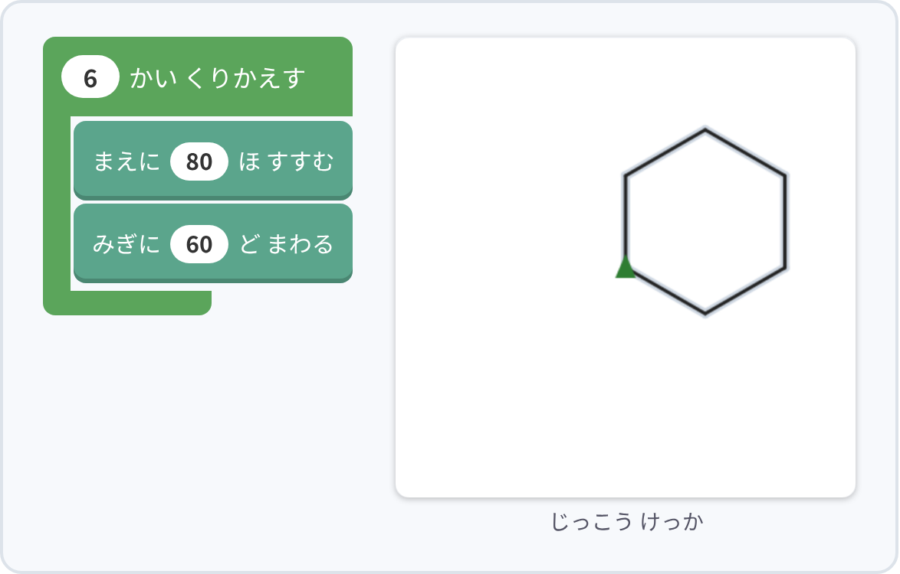

### ② ほし ★★

5回で2周（720°）するので、1回あたり 720 ÷ 5 = 144° まわります。

### ③ まる ★★


### ④ まど ★★★
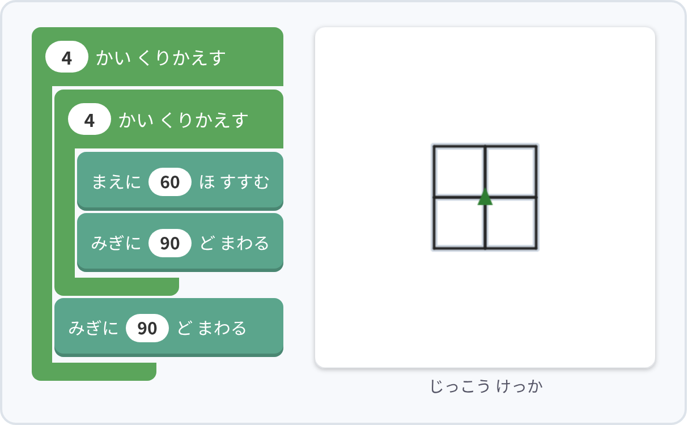

### ⑤ はな ★★★
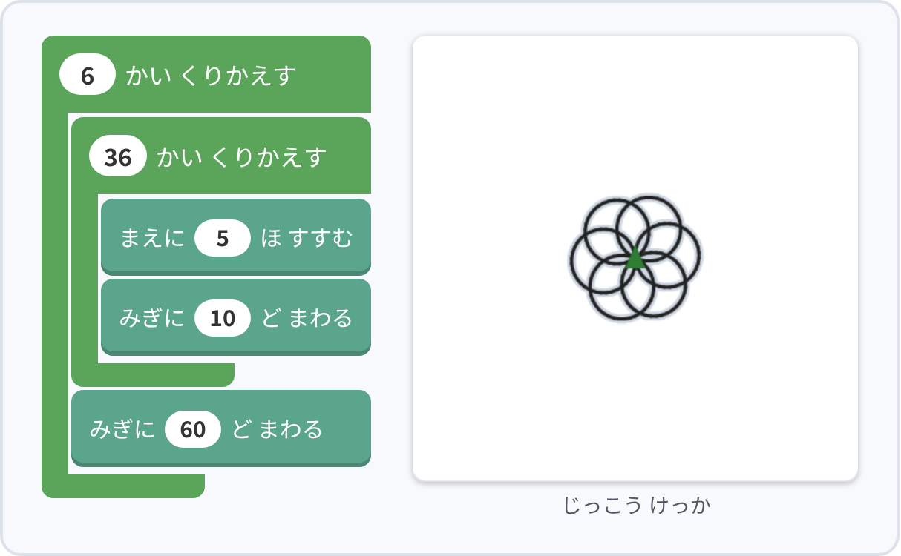

### ⑥ しかくい うずまき ★★★★
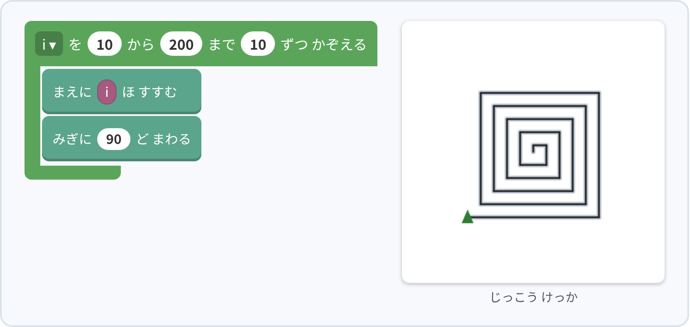

### ⑦ ならんだ たかくけい ★★★★

変数 n は「へんすう」カテゴリの「へんすうを作る」で作ります。

### ⑧ ゆきの けっしょう ★★★★★
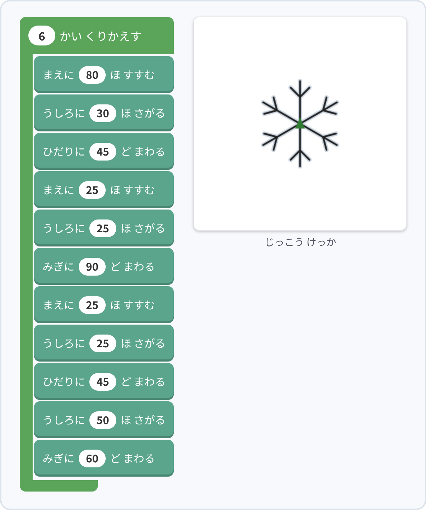
1本の枝をかいたら、向きも位置も元にもどすのがポイントです。

### ⑨ ほしの うずまき ★★★★★

ループの中に「ペンのいろを ランダム にする」を入れると、カラフルになります。

---

### おだいを増やすには

`index.html` の `CHALLENGES` に1つ追加します。

```js
{ title: '⑩ ○○ ★★★',
  text: '子どもに見せる説明',
  hint: 'ヒント',
  answer: 'for(let k=0;k<3;k++){forward(100);turn(120);}' }
```

`answer` にはお手本をかくプログラムを書きます。使える命令は次のとおりです。

- `forward(ほ)`：マイナスの値で後ろにさがる
- `turn(ど)`：マイナスの値で左にまわる
- `pen(true/false)`：ペンをおろす／あげる
- `home()`：まんなかにもどる

解答ブロックを付けるときは、`ANSWER_BLOCKS` にも同じ順番で追加します。

---

# ⛏ ブロックでめいろ

たんけんか（キャラクター）は、ヘルメットのライトが照らしている方向が「まえ」です。
ステージ4〜7の「めやす」は、使うブロックの数です（数字の入力欄は数えません）。

| ステージ | 学べること | 解答のブロック数 |
|---|---|---|
| 1 まっすぐ すすもう | 順番に並べる（順次） | 4 |
| 2 まがってみよう | 向きの考え方 | 5 |
| 3 ながい みち | 長い手順を組み立てる | 12 |
| 4 くりかえしを つかおう | くりかえし | 5（めやす 5） |
| 5 かいだんを のぼろう | パターンを見つける | 5（めやす 5） |
| 6 もし〜なら | 条件分岐、条件つきのくりかえし | 4（めやす 4） |
| 7 みぎ？ ひだり？ | 条件分岐の入れ子 | 6（めやす 6） |
| 8 どんな めいろでも | 一般化（アルゴリズム） | 7 |

### ステージ1　まっすぐ すすもう
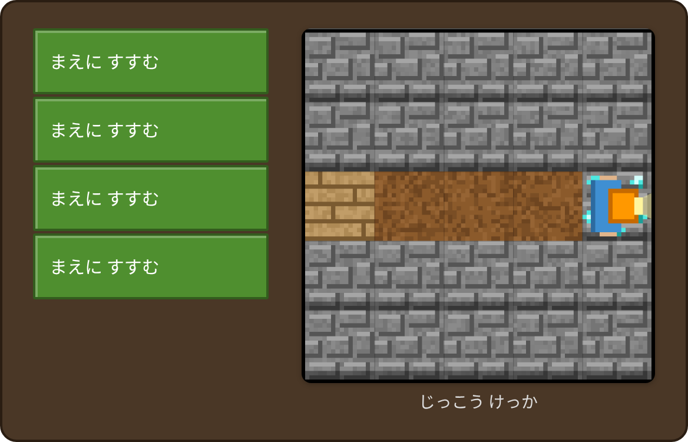

### ステージ2　まがってみよう

「むく」ではマスを動かず、向きだけが変わります。

### ステージ3　ながい みち

ブロックは全部で12個です。「長くて大変だった」という気づきが、次のステージのくりかえしにつながります。

### ステージ4　くりかえしを つかおう
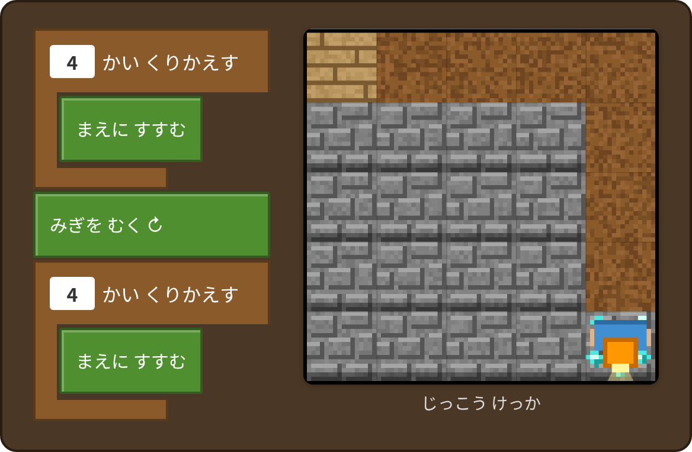

### ステージ5　かいだんを のぼろう
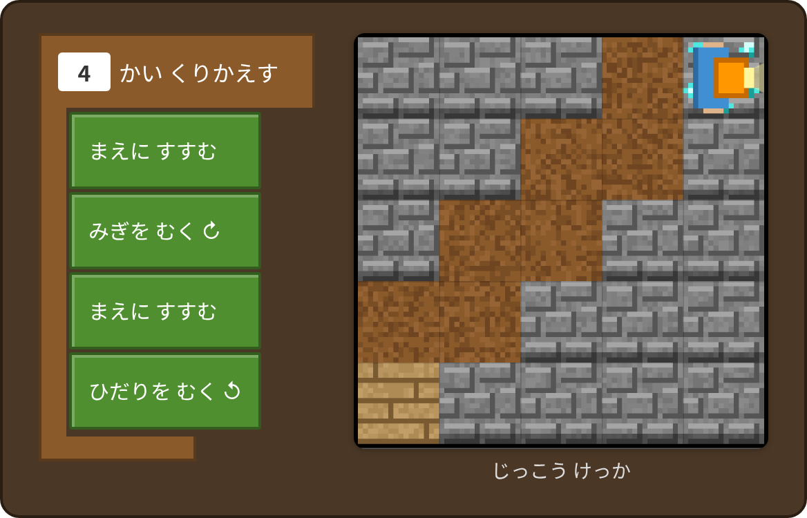
4回目の途中でゴールに着き、そこでプログラムが止まります。くりかえす回数を5にしても正解になります。

### ステージ6　もし〜なら

うずまきの道は右にしか曲がらないので、「前がだめなら右」だけで進めます。

### ステージ7　みぎ？ ひだり？
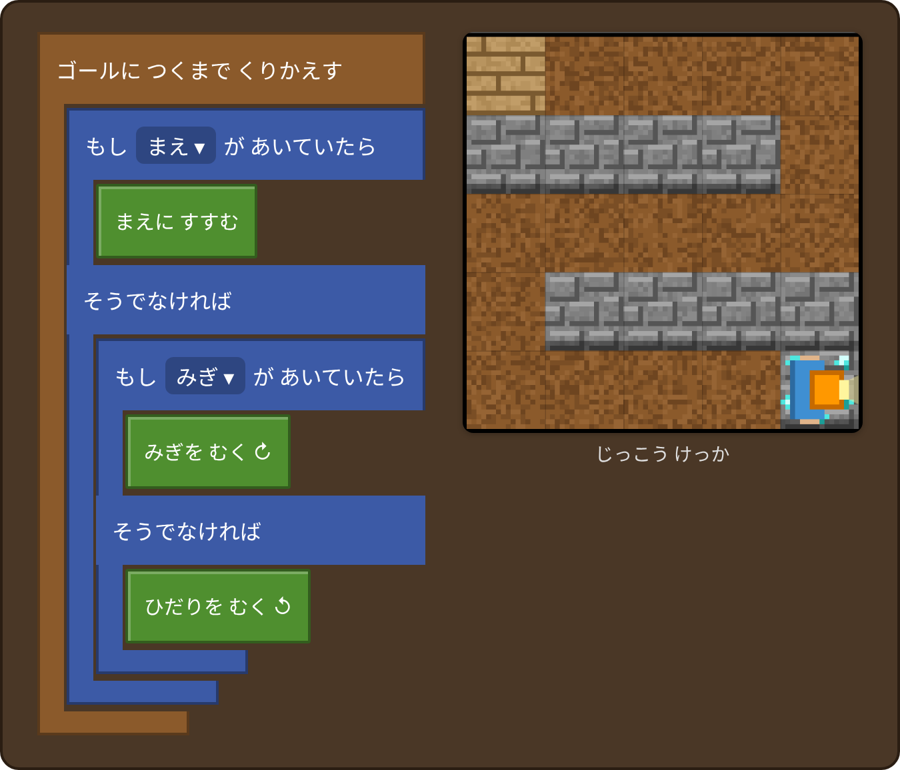
ステージ6のプログラムのままだと、右に曲がった先で行き止まりになります。そのまま同じところを回り続けて、「うごきが おおすぎるよ」と出て止まります。

### ステージ8　どんな めいろでも ゴール！（右手法）

右手を壁につけたまま歩く「右手法」です。スタートとゴールがどちらも外側の壁に接しているので、この迷路では必ずゴールに着きます。
ランダムな迷路900個で試して、すべてゴールできることを確かめています。

「みぎ」と「ひだり」を全部入れかえた「左手法」でも正解になります。ステージ7のプログラムは、迷路によっては同じところを回り続けてしまいます。なぜ失敗するのかを話し合うのもおすすめです。

### じゆうモード
ステージ8と同じプログラムで、どの迷路でもゴールできます。

---

# ⛏ めいろの なかま（やじるし・かぎと とびら・てき）

画像はなく、ブロックの並びを文字で書いています（字下げは「くりかえす」「もし」の中）。先生モード（URL に `?sensei`）の「📖 こたえ」で、ブロックを読み込めます。

## 🧭 やじるしの めいろ（maze-junior.html）

「むき」を考えずに、うえ・した・ひだり・みぎ の矢印で1マスずつ動きます（低学年向け）。

| ステージ | こたえ | ブロック数 |
|---|---|---|
| 1 みぎへ すすもう | みぎへ ×3 | 3 |
| 2 したへ まがろう | みぎへ → したへ ×3 → みぎへ ×2 | 6 |
| 3 かいだん | みぎへ → したへ → みぎへ → したへ → みぎへ → したへ | 6 |
| 4 うえへ のぼろう | うえへ ×3 → みぎへ ×3 | 6 |
| 5 ぐるっと まわろう | みぎへ ×2 → したへ ×2 → ひだりへ ×2 | 6 |
| 6 くりかえしを つかおう | 4かい くりかえす（みぎへ → したへ） | 3（めやす 3） |

## 🗝 かぎと とびらの めいろ（maze-key.html）

かぎ 🔑 の上で「かぎを ひろう」、とびら 🚪 の前で「とびらを あける」。かぎ1つで、とびらが1つ開きます。

**ステージ1　かぎを ひろって とびらを あけよう**（6こ）
```
まえに すすむ ×2 → かぎを ひろう → とびらを あける → まえに すすむ ×2
```
**ステージ2　かぎは どこ？**（16こ）
```
まえに すすむ ×2 → みぎを むく → まえに すすむ ×2 → みぎを むく → まえに すすむ ×2
かぎを ひろう → みぎを むく ×2 → まえに すすむ ×2 → とびらを あける → まえに すすむ ×2
```
**ステージ3　とびらが 2つ**（7こ、めやす 7）
```
2かい くりかえす
    まえに すすむ → かぎを ひろう → とびらを あける → まえに すすむ
みぎを むく → まえに すすむ
```
**ステージ4　じぶんで かんがえる たんけんか**（8こ、めやす 8）
```
ゴールに つくまで くりかえす
    もし ここに かぎが ある なら
        かぎを ひろう
    もし まえが とびら なら
        とびらを あける
    もし まえ が あいていたら
        まえに すすむ
    そうでなければ
        みぎを むく
```
つまずき：かぎを持たずにとびらへ進むと「とびらが あかないよ。かぎは どこかな？」、持っているのに「あける」を忘れると「とびらに ぶつかった！」と出ます。

## 👾 てきを よける めいろ（maze-enemy.html）

スライムは、たんけんかが1回動く（すすむ・むく・まつ）たびに1マス動き、端で引き返します。「まえが あぶない」は、前のマスにスライムがいる、または次に前のマスへ来るとき。

**ステージ1　まって よけよう**（6こ）
```
まえに すすむ → まつ ×2 → まえに すすむ ×3
```
**ステージ2　あぶなかったら まつ**（4こ、めやす 4）
```
ゴールに つくまで くりかえす
    もし まえが あぶなかったら
        まつ
    そうでなければ
        まえに すすむ
```
**ステージ3　おおきな めいろ ／ ステージ4　うずまきの めいろ**（6こ、めやす 6）
```
ゴールに つくまで くりかえす
    もし まえが あぶなかったら
        まつ
    そうでなければ
        もし まえ が あいていたら
            まえに すすむ
        そうでなければ
            みぎを むく
```
「まつ」を使わずに進むと、どのステージでもスライムにつかまります（「スライムに つかまっちゃった！」）。

# 🚀 うちゅうで ほしあつめ

宇宙飛行士（たんけんか）が、星 ⭐ を全部拾ってからロケット 🚀 に乗り込むとクリアです。
- 星を全部集める前にロケットのマスを通っても、クリアにはなりません。そのまま進めます
- 星のないマスで「ほしを ひろう」を使うと、失敗になります（「ここには ほしが ないよ！」）

| ステージ | 学べること | 解答のブロック数 |
|---|---|---|
| 1 ほしを ひろおう | 順次＋「ひろう」という動作 | 5 |
| 2 まがって あつめよう | 向きと順番 | 8 |
| 3 くりかえしで あつめよう | くりかえし | 4（めやす 4） |
| 4 ほしの かいだん | パターンを見つけてくりかえす | 6（めやす 6） |
| 5 もし ほしが あったら | 条件分岐（その場を調べる） | 4（めやす 4） |
| 6 ミッション クリアまで | 条件つきのくりかえし＋条件分岐 | 6（めやす 6） |
| 7 どんな うちゅうでも！ | 一般化（右手法＋調べて拾う） | 9 |

### ステージ1　ほしを ひろおう


### ステージ2　まがって あつめよう
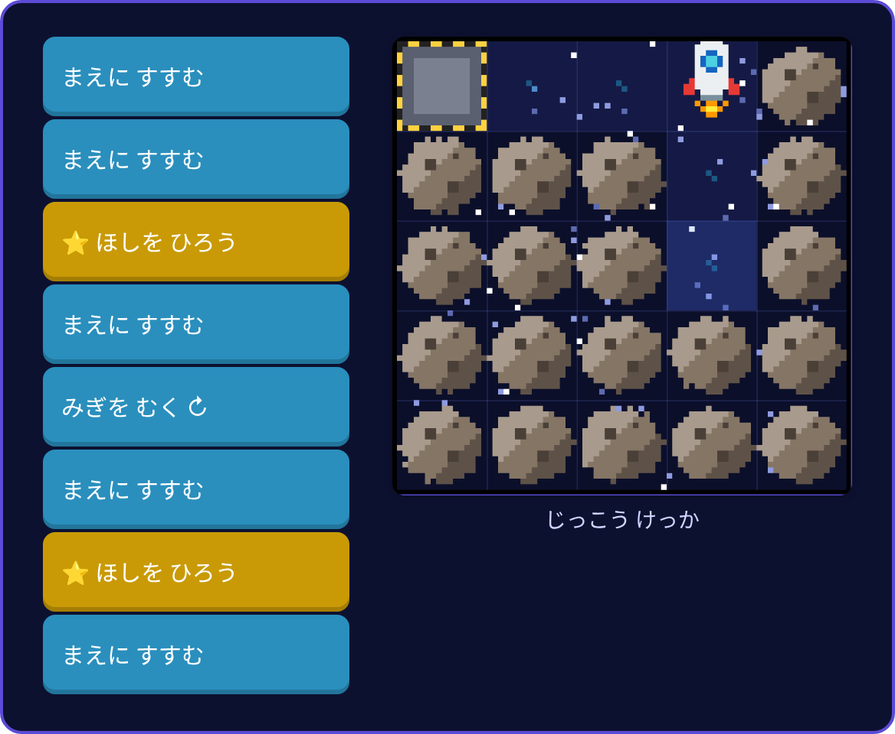

### ステージ3　くりかえしで あつめよう
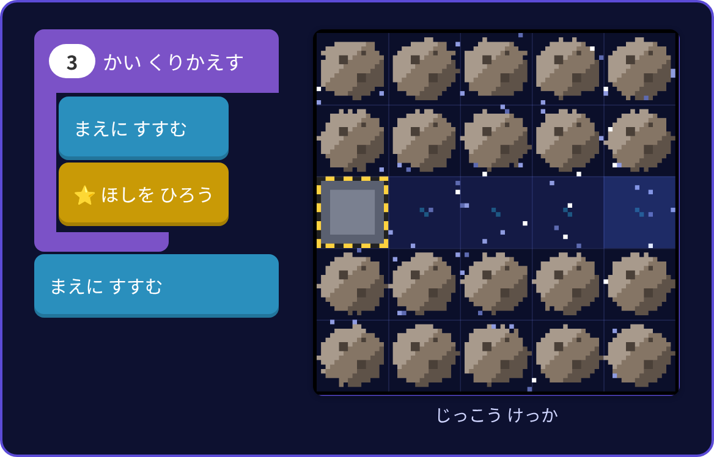
3回目に拾ったあと、もう1マス進むとロケットに着きます。

### ステージ4　ほしの かいだん
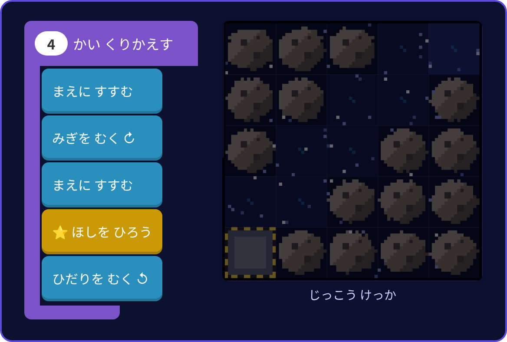
4回目のくりかえしの途中でロケットに着き、その時点でクリアになります。

### ステージ5　もし ほしが あったら
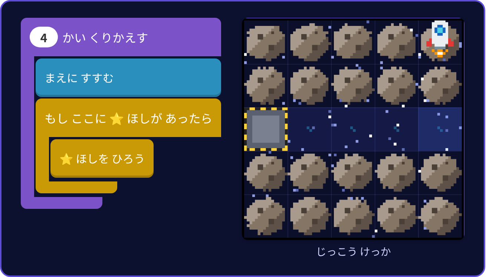
「もし」を使わずに「すすむ → ひろう」をくりかえすと、星のないマスで失敗します。
このステージで、「調べてから行動する」ことの大切さに気づけます。

### ステージ6　ミッション クリアまで
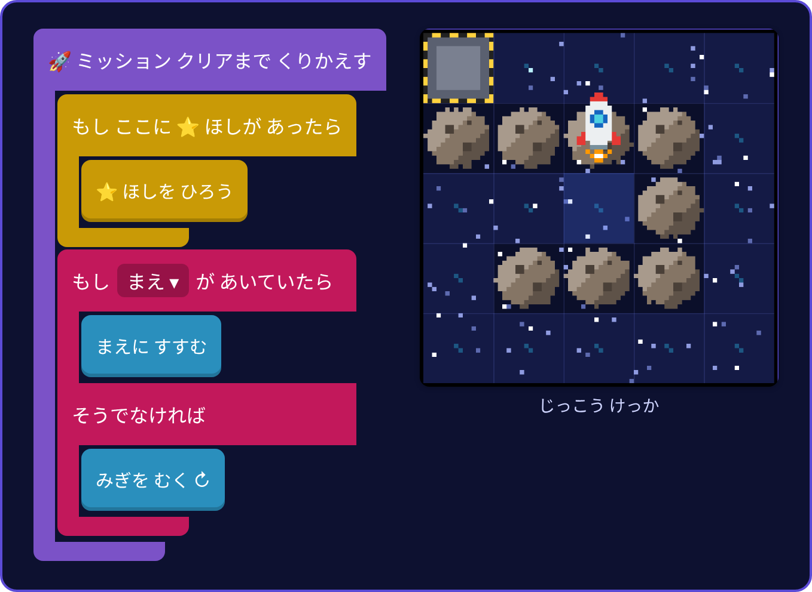
くりかえすたびに、まず足元の星を調べてから進みます。うずまきの道は右にしか曲がらないので、「前がだめなら右」で進めます。

### ステージ7　どんな うちゅうでも！
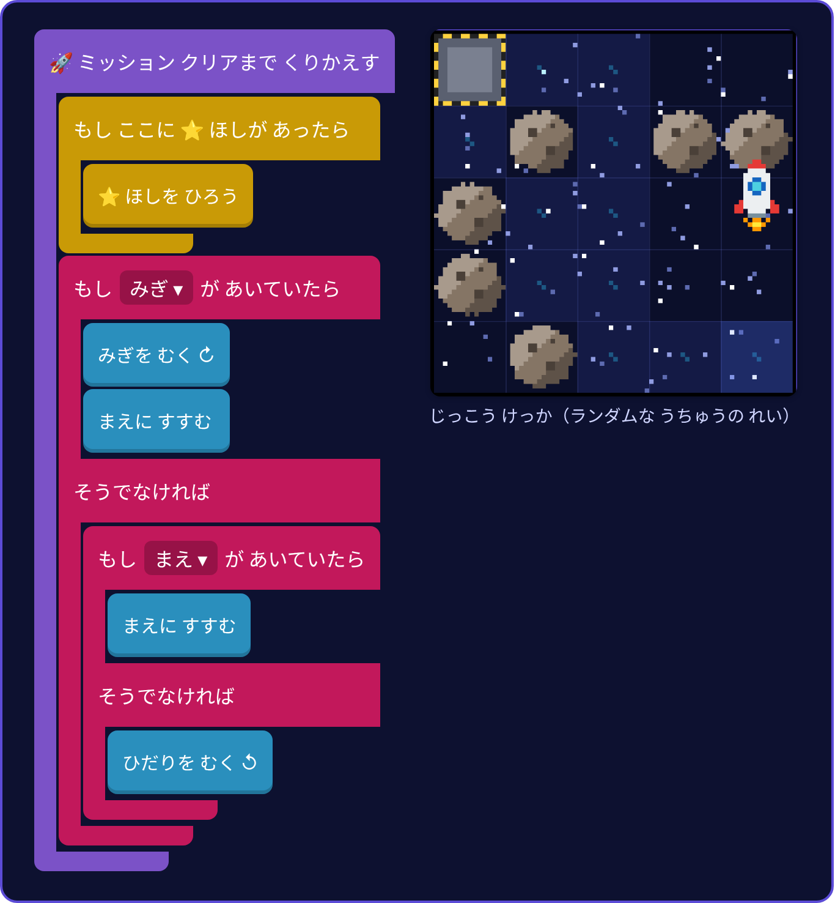
迷路のステージ8で使った「右手法」に、「もし ほしが あったら ひろう」を足したプログラムです。
星を集め終わる前にロケットを通り過ぎても、壁に沿って歩き続けるので、最後は星を全部拾ってロケットに戻ってきます。
テストに使うランダムな宇宙は、星が右手法で通る道の上に置かれるように作っています。この解答で、ランダムな宇宙1000個がすべてクリアできることを確かめています。

ステージ6のプログラムのままだと、同じところを回り続けて「うごきが おおすぎるよ」で止まります。

### じゆうモード
ステージ7と同じプログラムで、どの宇宙でもクリアできます。


---

# 🧱 こわして つくる ぼうけん

つるはしで石ブロックを「こわす」と、そのブロックが持ち物に入ります。持っているブロックを水の上に「おく」と、橋になって渡れます。たからばこに着くとクリアです。
- 黒いかたい岩はこわせません（「この いわは かたくて こわせない！」）
- 石ブロックや水に、そのまま進むと失敗します（「ぶつかった！」「みずに おちちゃった！」）
- ブロックを持っていないときに「おく」を使うと失敗します。持っている数は、盤面の上の「もっている ブロック」に表示されます

| ステージ | 学べること | 解答のブロック数 |
|---|---|---|
| 1 こわして すすもう | 「こわす」という動作 | 5 |
| 2 はしを かけよう | こわす → 持つ → おく、という手順 | 6 |
| 3 くりかえして こわそう | くりかえし | 4（めやす 4） |
| 4 ながい はし | 持っている数を使い切るくりかえし | 4（めやす 4） |
| 5 もし いしが あったら | 条件分岐（前を調べる） | 4（めやす 4） |
| 6 いしと みず | 2つの条件分岐、持っている数の増え減り | 6（めやす 6） |
| 7 うずまきの どうくつ | 条件つきのくりかえし＋3つの条件分岐 | 8（めやす 8） |

### ステージ1　こわして すすもう
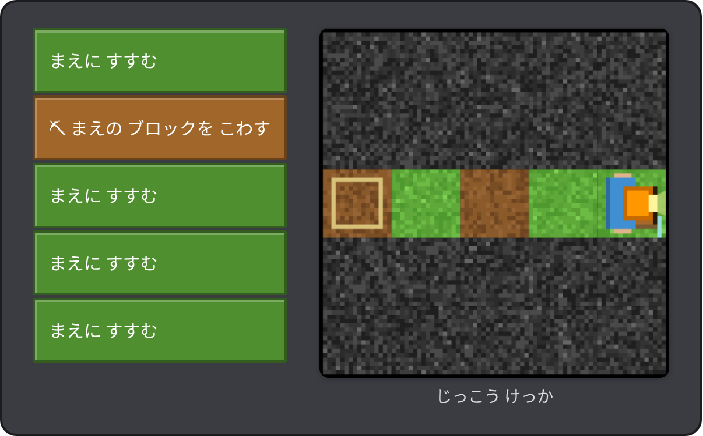

### ステージ2　はしを かけよう
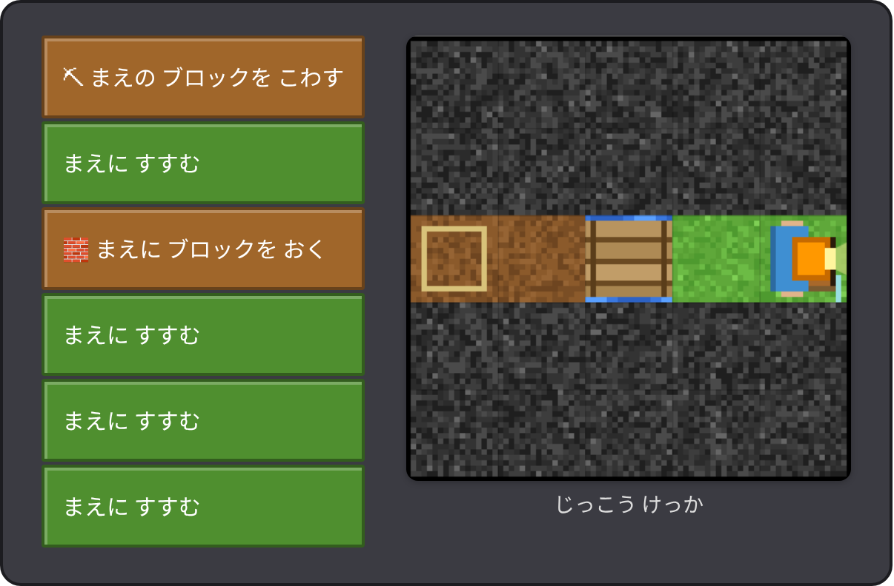
最初はブロックを持っていません。先に石をこわしてから水に置く、という順番に気づけるかがポイントです。

### ステージ3　くりかえして こわそう
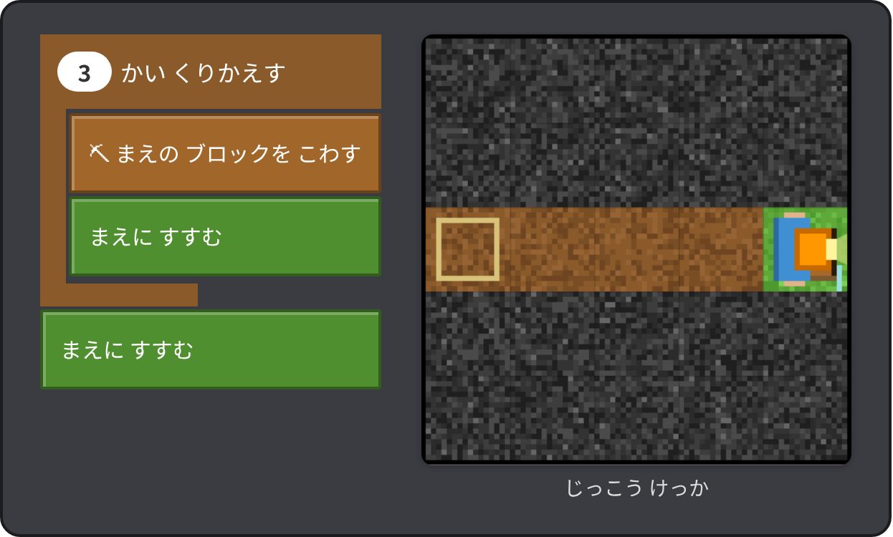

### ステージ4　ながい はし
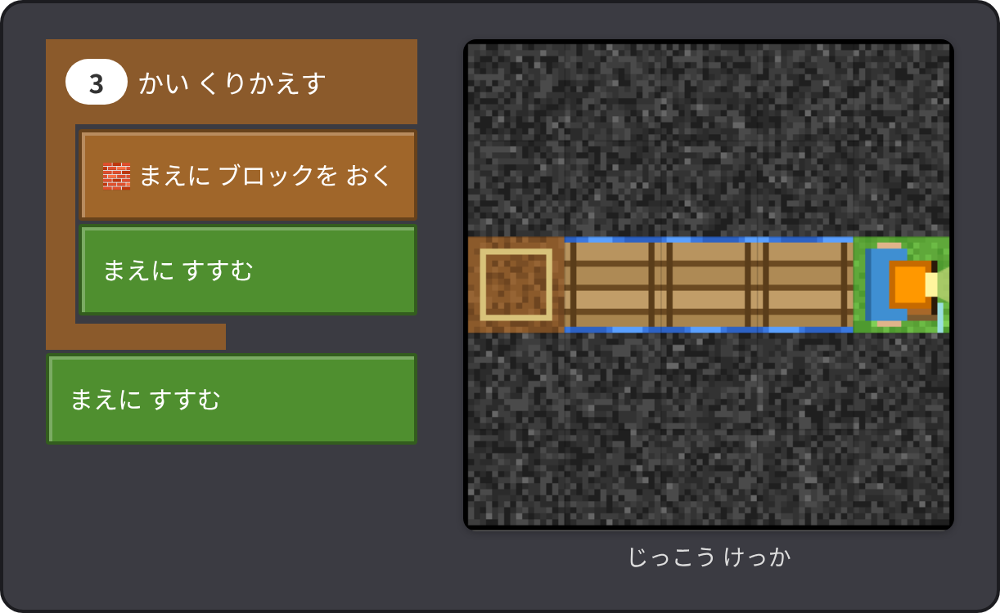
最初からブロックを3こ持っています。3回置くと、ちょうど0こになります。

### ステージ5　もし いしが あったら
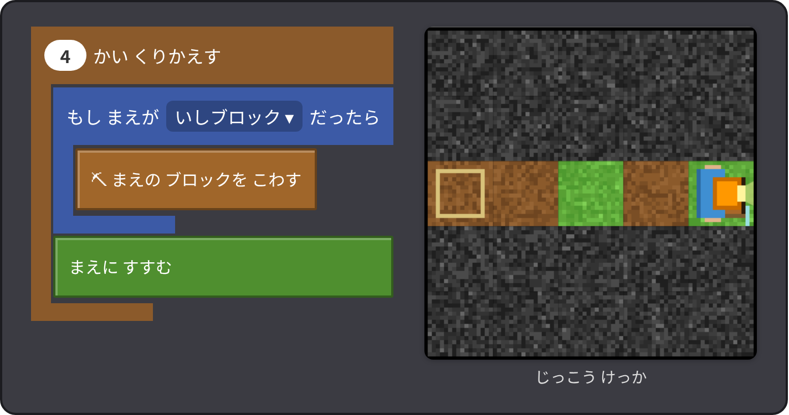
「もし」を使わずに「こわす → すすむ」をくりかえすと、石のないマスで失敗します。

### ステージ6　いしと みず
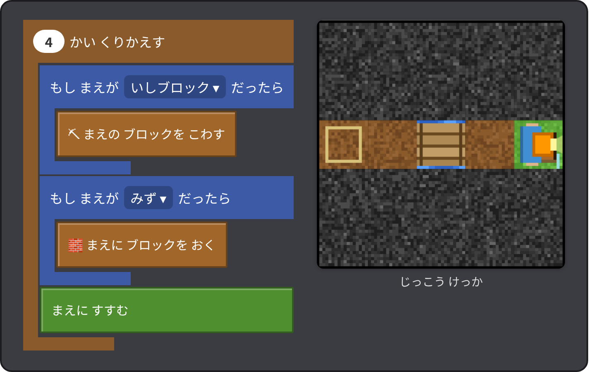
石をこわすと持ち物が1こ増え、水に置くと1こ減ります（0 → 1 → 0 → 1）。

### ステージ7　うずまきの どうくつ
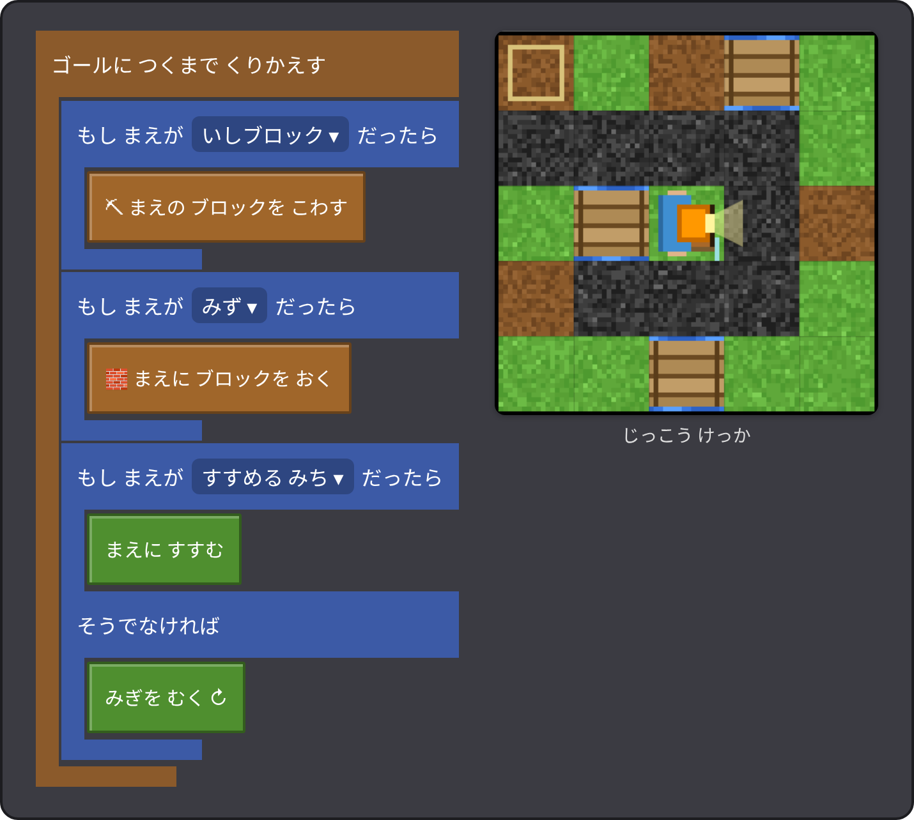
くりかえすたびに、まず前が石ならこわし、水なら橋を置きます。そのあと前に進めれば進み、進めなければ（かたい岩や外の壁なら）右を向きます。
ステージ6のプログラムのままだと、曲がり角で進めずに「ゴールに つかなかったよ」になります。

### じゆうモード
ランダムな世界です。水の数（3こ）と同じ数のブロックを持ってスタートするので、どの世界でもクリアできます。決まった解答はないので、先生モードの「こたえ」は読み込めません。

---

# 🐍 Pythonで おえかき（python-draw.html）

ブロックモードで組むと、下の Python と同じ動きになります。Python モードでは、このコードをそのまま書けば正解です。

### ① 六角形（ろっかくけい） ★

**ポイント**：forward() と right() の () の なかに かずを かく。for の なかの 2ぎょうを 6かい くりかえすよ。

```python
for i in range(6):
    forward(80)
    right(60)
```

### ② ほし ★★

**ポイント**：5かいで 720ど（2しゅう）まわるから、1かいは 720 ÷ 5 = 144 ど。

```python
for i in range(5):
    forward(150)
    right(144)
```

### ③ まる ★★

**ポイント**：10ど ずつ 36かい まわると 360ど。ちいさな せんを たくさん つなぐと まるに 見えるよ。

```python
for i in range(36):
    forward(10)
    right(10)
```

### ④ まど ★★★

**ポイント**：なかの for は スペース 8つ じさげ。しかくを かいたら、そとの for の なかで right(90)。

```python
for i in range(4):
    for k in range(4):
        forward(60)
        right(90)
    right(90)
```

### ⑤ はな ★★★

**ポイント**：まる 1こが なかの for。そとの for で 360 ÷ 6 = 60 ど まわしながら 6かい。

```python
for i in range(6):
    for k in range(36):
        forward(5)
        right(10)
    right(60)
```

### ⑥ しかくい うずまき ★★★★

**ポイント**：range(10, 201, 10) は 10, 20, … 200。おわりの かずは ふくまない ので 201 に する。forward(i) で だんだん ながく。

```python
for i in range(10, 201, 10):
    forward(i)
    right(90)
```

### ⑦ ならんだ たかくけい ★★★★

**ポイント**：n かくけいの まわる かくどは 360 / n。range(3, 9) で n は 3〜8。

```python
for n in range(3, 9):
    for i in range(n):
        forward(50)
        right(360 / n)
```

### ⑧ ゆきの けっしょう ★★★★★

**ポイント**：えだ 1本は 10ぎょう。もとの ばしょと むきに もどるので、right(60) で つぎの えだへ。

```python
for i in range(6):
    forward(80)
    back(30)
    left(45)
    forward(25)
    back(25)
    right(90)
    forward(25)
    back(25)
    left(45)
    back(50)
    right(60)
```

### ⑨ ほしの うずまき ★★★★★

**ポイント**：すすむ ながさ i * 4 が 4ほ ずつ のびて、144ど まわると ほしの うずまきに なる。

```python
for i in range(1, 51):
    pen_color('random')
    forward(i * 4)
    right(144)
```

---

# 🐍 Pythonで めいろ（python.html）

ブロックモードで組むと、下の Python と同じ動きになります。Python モードでは、このコードをそのまま書けば正解です。

### ステージ1　まっすぐ すすもう

**ポイント**：Python は うえの ぎょうから じゅんばんに うごく。ブロックの「まえに すすむ」＝ forward()

```python
forward()
forward()
forward()
forward()
```

### ステージ2　まがってみよう

**ポイント**：むきを かえても マスは うごかない。「_」（アンダーバー）も わすれずに。

```python
forward()
forward()
turn_right()
forward()
forward()
```

### ステージ3　for で くりかえそう

**ポイント**：「:」の つぎの ぎょうを じさげ すると、その ぎょうが くりかえしの なかみ に なる。じさげを もどすと くりかえしの そと。

```python
for i in range(4):
    forward()
turn_right()
for i in range(4):
    forward()
```

### ステージ4　while と if

**ポイント**：not は「〜でない」。while not at_goal() ＝「ゴールに ついていない あいだ くりかえす」。

```python
while not at_goal():
    if is_open('front'):
        forward()
    else:
        turn_right()
```

### ステージ5　elif で 3つに わけよう

**ポイント**：elif は「そうでなくて もし」。ブロックで「そうでなければ」の なかに「もし」を いれると、Python では elif に なるよ。

```python
while not at_goal():
    if is_open('front'):
        forward()
    elif is_open('right'):
        turn_right()
    else:
        turn_left()
```

---

# 🐍 Pythonで うちゅう（python-space.html）

ブロックモードで組むと、下の Python と同じ動きになります。Python モードでは、このコードをそのまま書けば正解です。

### ステージ1　ほしを ひろおう

**ポイント**：pick_up() は いま いる マスの ほしを ひろう めいれい。ほしを ぜんぶ ひろってから ロケットへ！

```python
forward()
forward()
pick_up()
forward()
forward()
```

### ステージ2　まがって あつめよう

**ポイント**：turn_right() は その ばで むきを かえるだけ。まがる ばしょと ひろう ばしょの じゅんばんが だいじ。

```python
forward()
forward()
pick_up()
forward()
turn_right()
forward()
pick_up()
forward()
```

### ステージ3　for で あつめよう

**ポイント**：for の なかに 2ぎょう いれるには、どちらも スペース 4つ じさげ する。さいごの forward() は じさげ しない。

```python
for i in range(3):
    forward()
    pick_up()
forward()
```

### ステージ4　ほしの かいだん

**ポイント**：5ぎょうの セットを まるごと for の なかへ。4かいめの とちゅうで ロケットに つくと そこで おわるよ。

```python
for i in range(4):
    forward()
    turn_right()
    forward()
    pick_up()
    turn_left()
```

### ステージ5　if has_star():

**ポイント**：if の なかの ぎょうは、for より もう 1だん（ぜんぶで スペース 8つ）じさげ する。

```python
for i in range(4):
    forward()
    if has_star():
        pick_up()
```

### ステージ6　while not mission_done():

**ポイント**：mission_done() は「ほしを ぜんぶ ひろって ロケットに ついた」ときに True に なる。not で「まだの あいだ」くりかえす。

```python
while not mission_done():
    if has_star():
        pick_up()
    if is_open('front'):
        forward()
    else:
        turn_right()
```

---

# 🐍 Pythonで こわす・おく（python-craft.html）

ブロックモードで組むと、下の Python と同じ動きになります。Python モードでは、このコードをそのまま書けば正解です。

### ステージ1　こわして すすもう

**ポイント**：mine() で まえの いしを こわすと、すすめる みちに なるよ。

```python
forward()
mine()
forward()
forward()
forward()
```

### ステージ2　はしを かけよう

**ポイント**：さいしょは ブロックを もっていない。mine() で 1こ もってから place() で はしを かける。

```python
mine()
forward()
place()
forward()
forward()
forward()
```

### ステージ3　for で こわそう

**ポイント**：「mine() → forward()」を 3かい。さいごの forward() は for の そと（じさげ しない）。

```python
for i in range(3):
    mine()
    forward()
forward()
```

### ステージ4　ながい はし

**ポイント**：3こ もっているから、3かい place() すると ちょうど 0こ。

```python
for i in range(3):
    place()
    forward()
forward()
```

### ステージ5　if front_is('stone'):

**ポイント**：front_is('stone') は まえが いしなら True。if の なかは もう 1だん じさげ。

```python
for i in range(4):
    if front_is('stone'):
        mine()
    forward()
```

### ステージ6　elif で いしと みず

**ポイント**：いし → mine()、そうでなくて みず → place()。こわすと 1こ ふえて、おくと 1こ へる（0 → 1 → 0 → 1）。

```python
for i in range(4):
    if front_is('stone'):
        mine()
    elif front_is('water'):
        place()
    forward()
```

### ステージ7　うずまきの どうくつ

**ポイント**：if・elif・elif・else で 4つの ばあいに わける。くりかえす たびに まえを しらべなおすよ。

```python
while not at_goal():
    if front_is('stone'):
        mine()
    elif front_is('water'):
        place()
    elif front_is('path'):
        forward()
    else:
        turn_right()
```

---
# English answers

This section has the answers for the four block apps and the four 🐍 Python apps. In every image, the blocks are on the left and the result is on the right (🐍 Python shows the answer code).
These images show the English block labels. To see the same blocks in the app, switch the language with **⚙ Settings → 🌐**.

- 🐢 **Block Drawing** (index.html): challenges ①–⑨
- ⛏ **Block Maze** (maze.html): stages 1–8
- 🚀 **Space Star Hunt** (space.html): stages 1–7
- 🧱 **Break & Build Quest** (craft.html): stages 1–7
- 🐍 **Python Drawing** (python-draw.html): challenges ①–⑨
- 🐍 **Python Maze** (python.html): stages 1–5
- 🐍 **Python Space** (python-space.html): stages 1–6
- 🐍 **Python Break & Build** (python-craft.html): stages 1–7

## 📖 Teacher mode (load the answer blocks)

Add `?sensei` to the end of the URL. A "📖 Answer" button appears in the header.

```
https://<user>.github.io/<repository>/index.html?sensei&lang=en
https://<user>.github.io/<repository>/maze.html?sensei&lang=en
https://<user>.github.io/<repository>/space.html?sensei&lang=en
https://<user>.github.io/<repository>/craft.html?sensei&lang=en
https://<user>.github.io/<repository>/python-draw.html?sensei&lang=en
https://<user>.github.io/<repository>/python.html?sensei&lang=en
https://<user>.github.io/<repository>/python-space.html?sensei&lang=en
https://<user>.github.io/<repository>/python-craft.html?sensei&lang=en
```

Press the button to load the answer blocks for the selected challenge or stage. Then press "▶ Run" to show how it works in class.
Loading an answer replaces the blocks the student had built for that challenge or stage.

---

# 🐢 Block Drawing

When you choose a challenge, a light gray model drawing appears.
After "▶ Run" finishes, the app compares your lines with the model and checks the answer automatically.
Only the shape and position of the lines are checked. Colors and pen sizes can be anything.
The turtle starts in the center, facing up.

| # | Challenge | What students learn |
|---|---|---|
| ① | Hexagon | Repeat; exterior angle = 360 ÷ number of corners |
| ② | Star | A shape that turns around twice (720°) |
| ③ | Circle | Making a circle from many short lines |
| ④ | Window | A loop inside a loop (nested loops) |
| ⑤ | Flower | Nested loops + rotation symmetry |
| ⑥ | Square spiral | Using a variable (counter) as a length |
| ⑦ | Polygons in a row | Variable + math block (360 ÷ n) |
| ⑧ | Snowflake | Breaking a task into steps; "coming back to the start" |
| ⑨ | Star spiral | Variable × math + turning |

### ① Hexagon ★
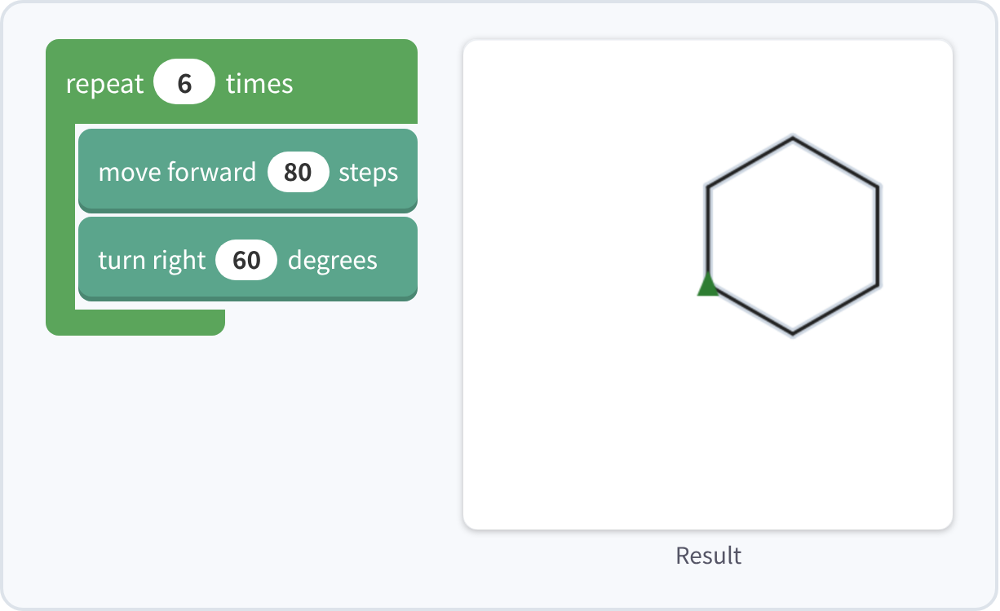

### ② Star ★★
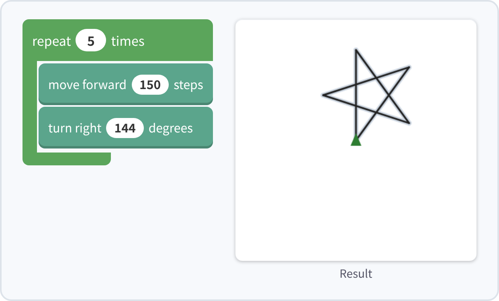
The turtle turns around twice (720°) in 5 repeats, so each turn is 720 ÷ 5 = 144°.

### ③ Circle ★★
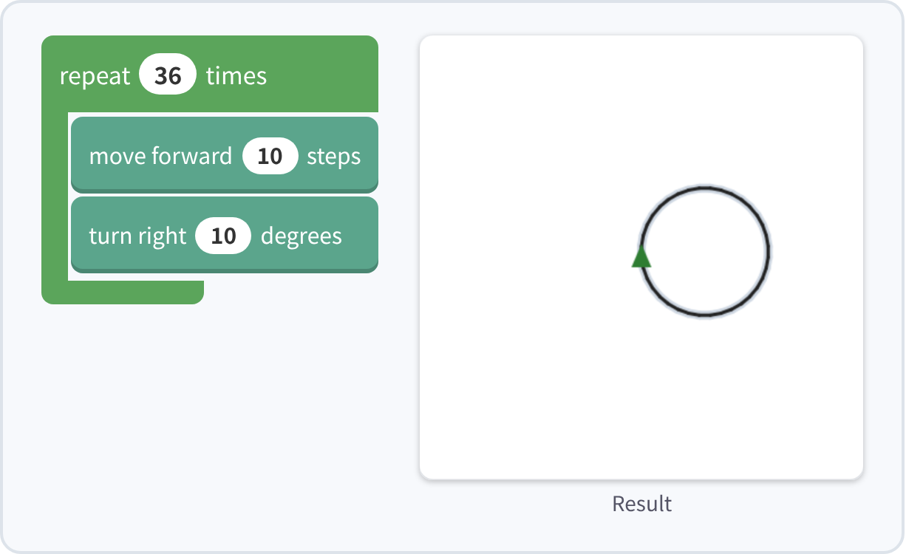

### ④ Window ★★★
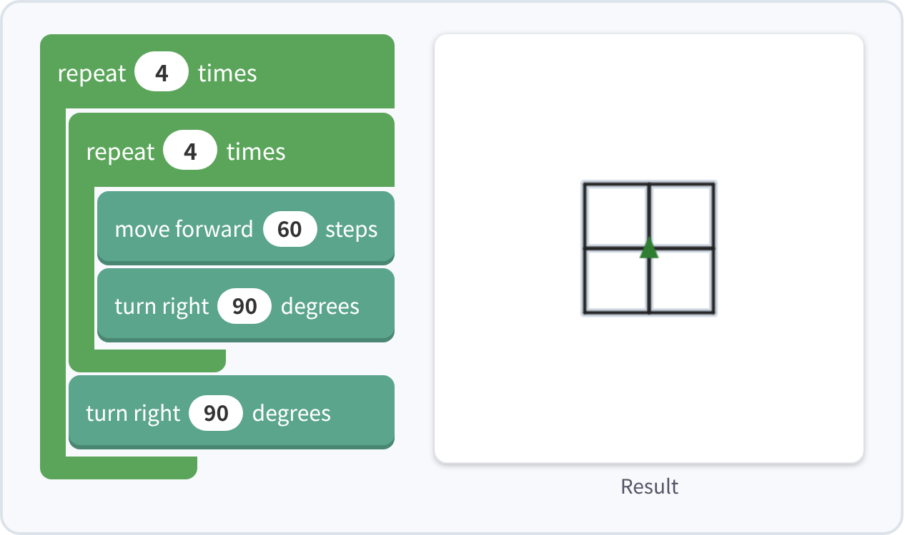

### ⑤ Flower ★★★
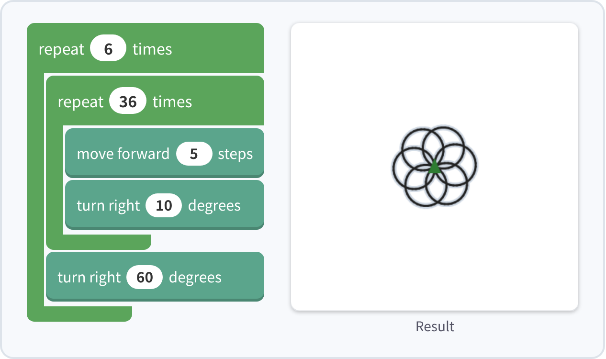

### ⑥ Square spiral ★★★★
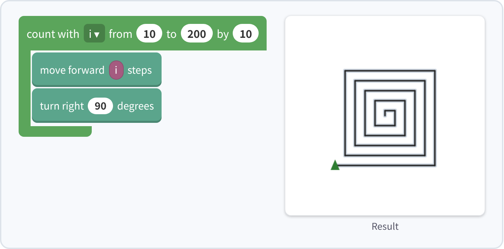

### ⑦ Polygons in a row ★★★★
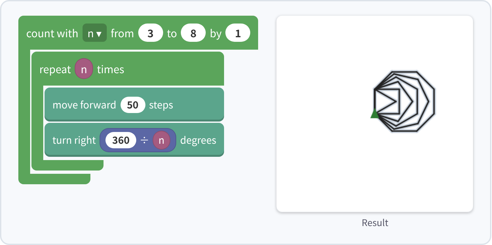
Make the variable n with "Create variable…" in the Variables category.

### ⑧ Snowflake ★★★★★
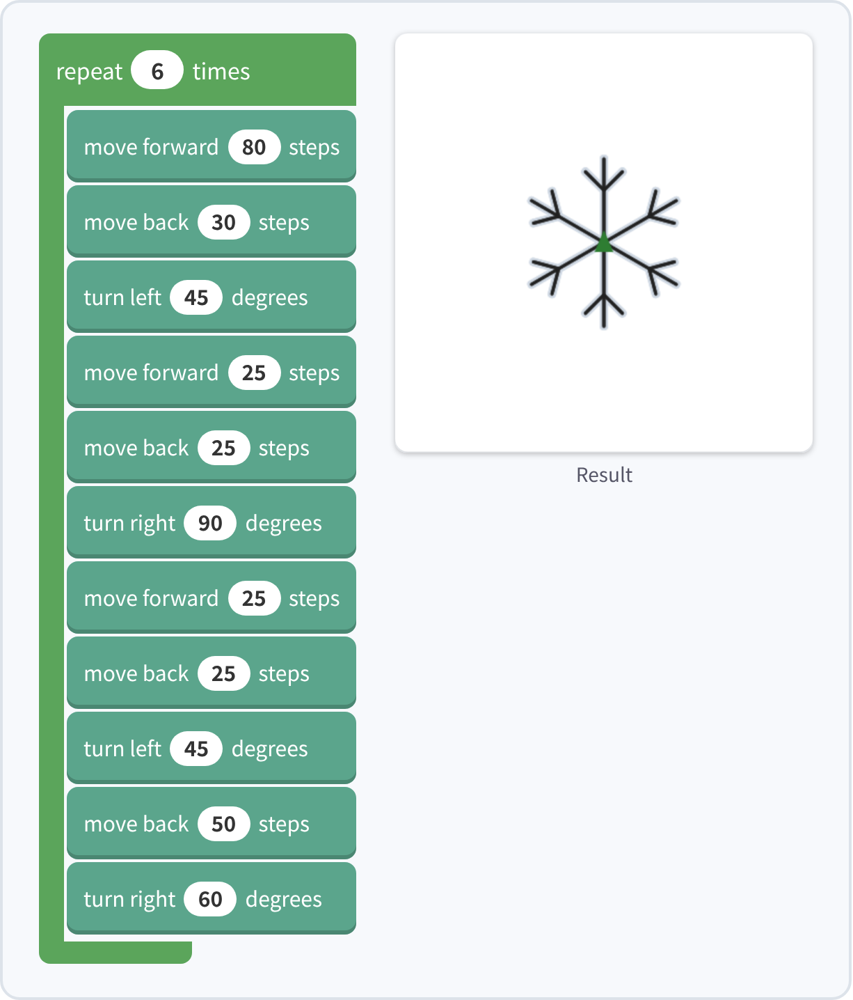
The key is to put both the position and the direction back after drawing each branch.

### ⑨ Star spiral ★★★★★
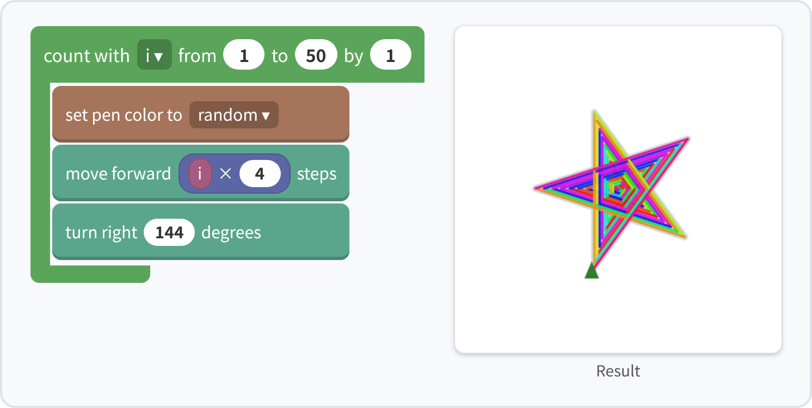
Put "set pen color to random" inside the loop to make it colorful.

---

# ⛏ Block Maze

"Forward" is the way the explorer's helmet light is shining.
In stages 4–7, the "target" is the number of blocks used (number inputs are not counted).

| Stage | What students learn | Blocks in the answer |
|---|---|---|
| 1 Go straight | Putting steps in order (sequence) | 4 |
| 2 Let's turn | Thinking about direction | 5 |
| 3 A long path | Building a long sequence | 12 |
| 4 Use a loop | Loops | 5 (target 5) |
| 5 Climb the stairs | Finding a pattern | 5 (target 5) |
| 6 If… | Conditions; repeat until | 4 (target 4) |
| 7 Right? Left? | Nested conditions | 6 (target 6) |
| 8 Any maze! | Generalizing (an algorithm) | 7 |

### Stage 1: Go straight
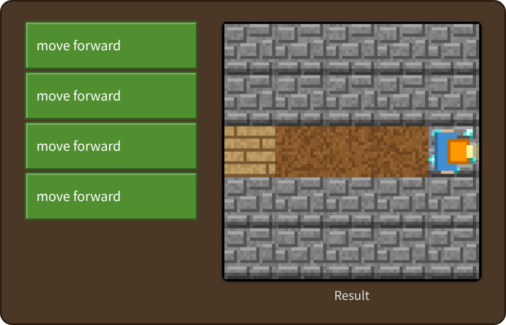

### Stage 2: Let's turn
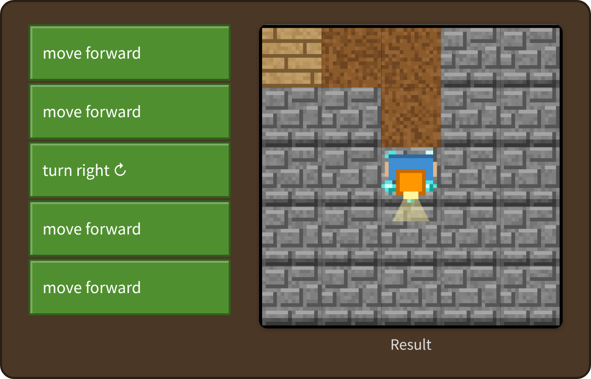
"Turn" changes only the direction. The explorer stays on the same square.

### Stage 3: A long path

This takes 12 blocks. Noticing "this is long and tiring" leads to loops in the next stage.

### Stage 4: Use a loop
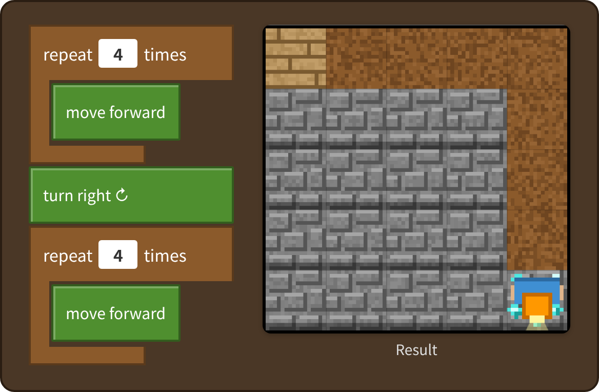

### Stage 5: Climb the stairs
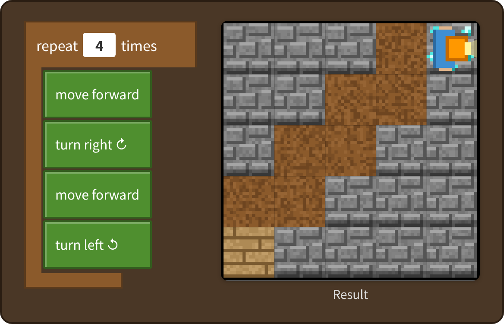
The explorer reaches the goal in the middle of the 4th repeat, and the program stops there. Repeating 5 times is also correct.

### Stage 6: If…
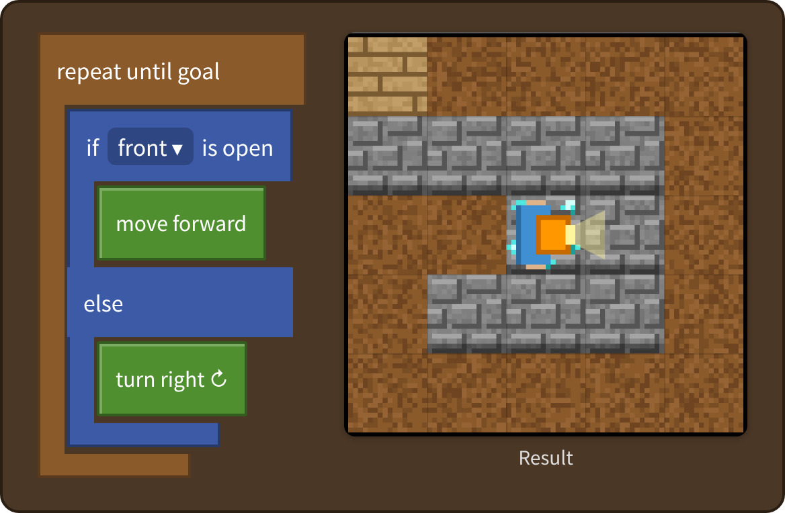
The spiral path only turns right, so "if the front is blocked, turn right" is enough.

### Stage 7: Right? Left?
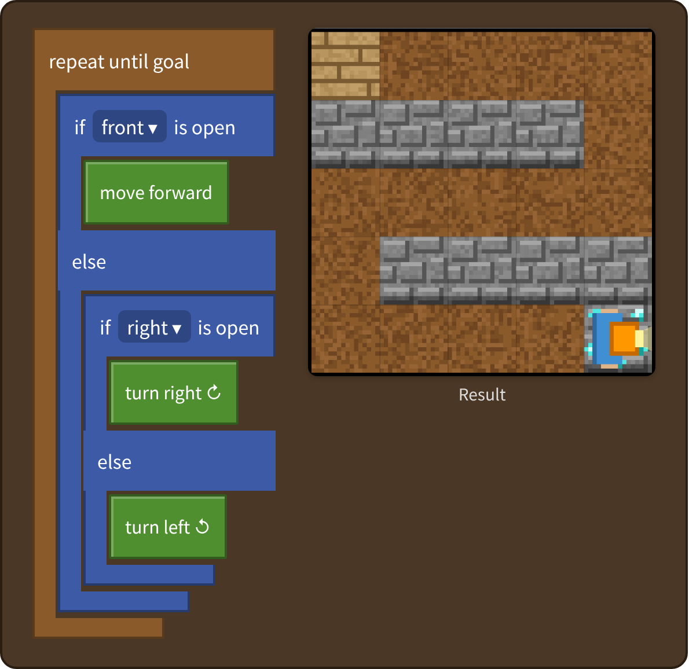
With the Stage 6 program, the explorer reaches a dead end after turning right. It keeps going around in the same place and stops with "Too many moves".

### Stage 8: Any maze! (the right-hand rule)
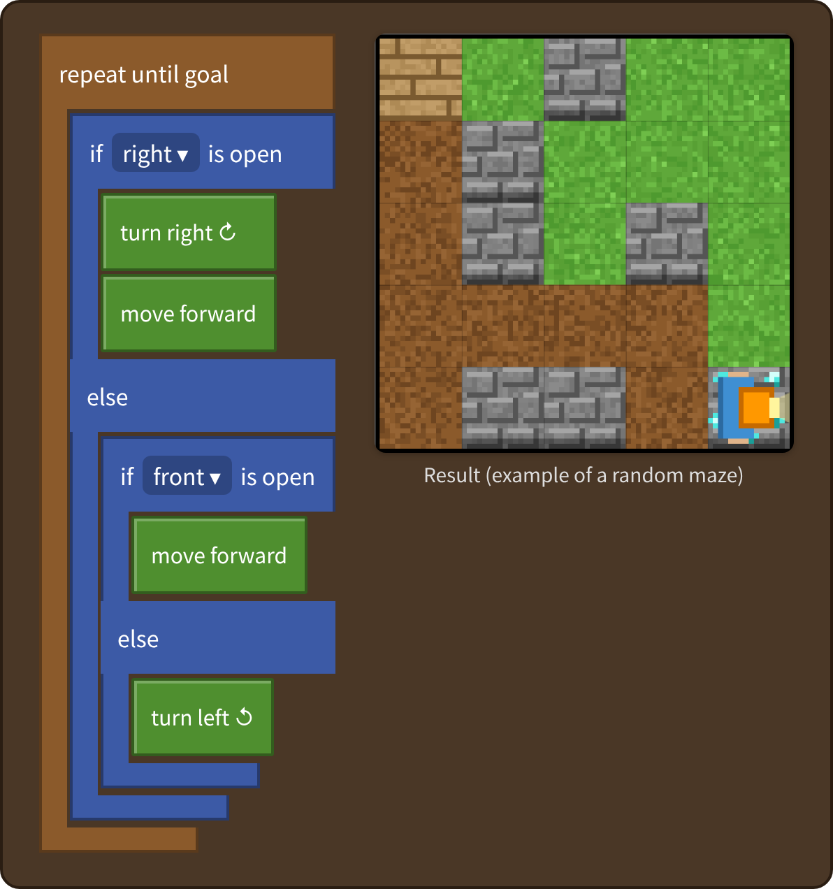
This is the "right-hand rule": walk with your right hand touching the wall. In these mazes, the start and the goal both touch the outer wall, so it always reaches the goal.
We checked it on 900 random mazes, and it reached the goal every time.

Swapping every "right" and "left" (the left-hand rule) also works. The Stage 7 program can get stuck going around in circles in some mazes. Talking about why it fails is a good class discussion.

### Free mode
The Stage 8 program reaches the goal in any maze.

---

# ⛏ Maze family (Arrow / Keys & Doors / Slime)

No pictures: the blocks are written as text (indented = inside "repeat" or "if"). In teacher mode (`?sensei`), "📖 Answer" loads the blocks.

## 🧭 Arrow Maze (maze-junior.html)

| Stage | Answer | Blocks |
|---|---|---|
| 1 Go right | right ×3 | 3 |
| 2 Go down | right → down ×3 → right ×2 | 6 |
| 3 Stairs | right → down → right → down → right → down | 6 |
| 4 Go up | up ×3 → right ×3 | 6 |
| 5 Go around | right ×2 → down ×2 → left ×2 | 6 |
| 6 Use repeat | repeat 4 (right → down) | 3 (target 3) |

## 🗝 Keys & Doors Maze (maze-key.html)

1. forward ×2 → pick up key → open door → forward ×2 (6)
2. forward ×2 → turn right → forward ×2 → turn right → forward ×2 → pick up key → turn right ×2 → forward ×2 → open door → forward ×2 (16)
3. repeat 2 (forward → pick up key → open door → forward) → turn right → forward (7, target 7)
4. repeat until goal: if key here (pick up key); if door in front (open door); if front is open (forward) else (turn right) (8, target 8)

## 👾 Dodge the Slime Maze (maze-enemy.html)

1. forward → wait ×2 → forward ×3 (6)
2. repeat until goal: if danger ahead (wait) else (forward) (4, target 4)
3. and 4. repeat until goal: if danger ahead (wait) else (if front is open (forward) else (turn right)) (6, target 6)

# 🚀 Space Star Hunt

The astronaut must pick up every star ⭐ and then board the rocket 🚀.
- Passing over the rocket before collecting all the stars does not end the mission. The astronaut keeps going
- Using "pick up star" on a square with no star is a mistake ("There is no star here!")

| Stage | What students learn | Blocks in the answer |
|---|---|---|
| 1 Pick up a star | Sequence + the "pick up" action | 5 |
| 2 Turn and collect | Direction and order | 8 |
| 3 Collect with a loop | Loops | 4 (target 4) |
| 4 Star stairs | Finding a pattern to repeat | 6 (target 6) |
| 5 If there is a star | Conditions (checking the current square) | 4 (target 4) |
| 6 Until mission complete | Repeat until + conditions | 6 (target 6) |
| 7 Any space! | Generalizing (right-hand rule + check and pick up) | 9 |

### Stage 1: Pick up a star
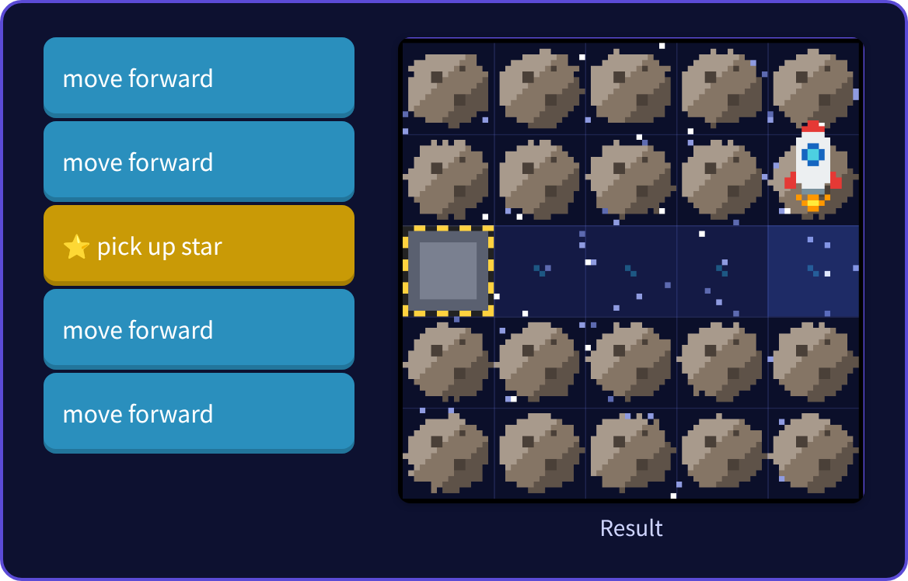

### Stage 2: Turn and collect


### Stage 3: Collect with a loop
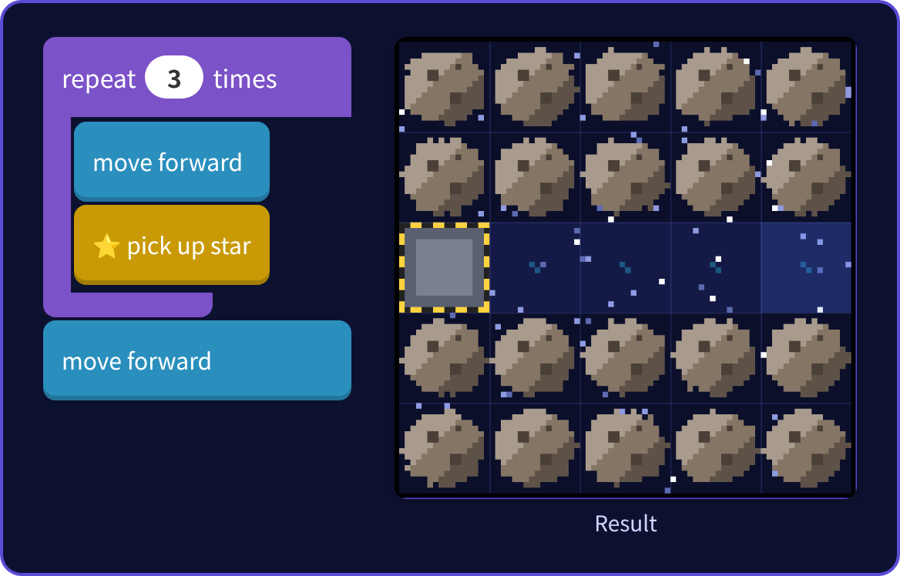
After the 3rd pick-up, one more step reaches the rocket.

### Stage 4: Star stairs
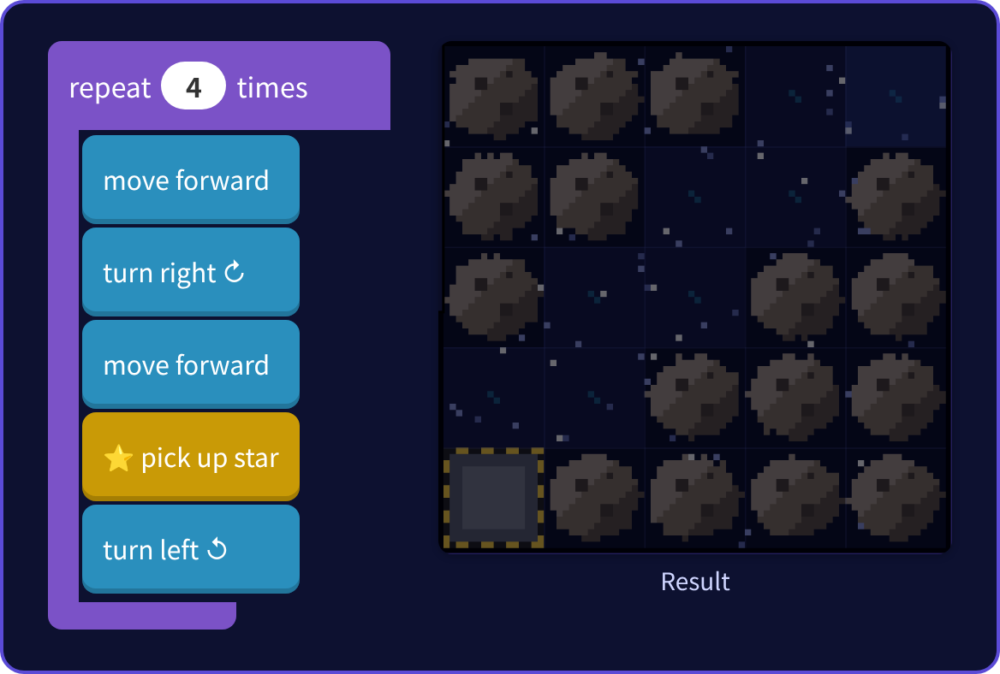
The astronaut reaches the rocket in the middle of the 4th repeat, and the mission is complete at that moment.

### Stage 5: If there is a star
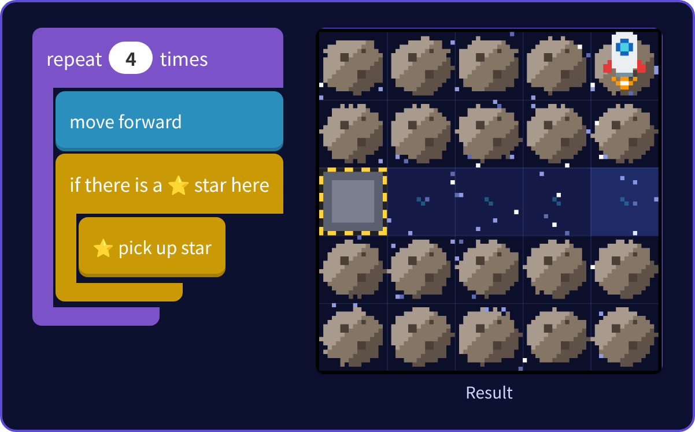
Without "if", repeating "move → pick up" fails on a square with no star.
This stage shows why it is important to check first and then act.

### Stage 6: Until mission complete
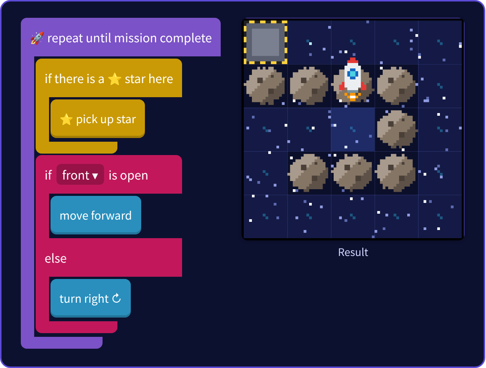
Each time through the loop, the astronaut first checks for a star, then moves. The spiral only turns right, so "if the front is blocked, turn right" is enough.

### Stage 7: Any space!
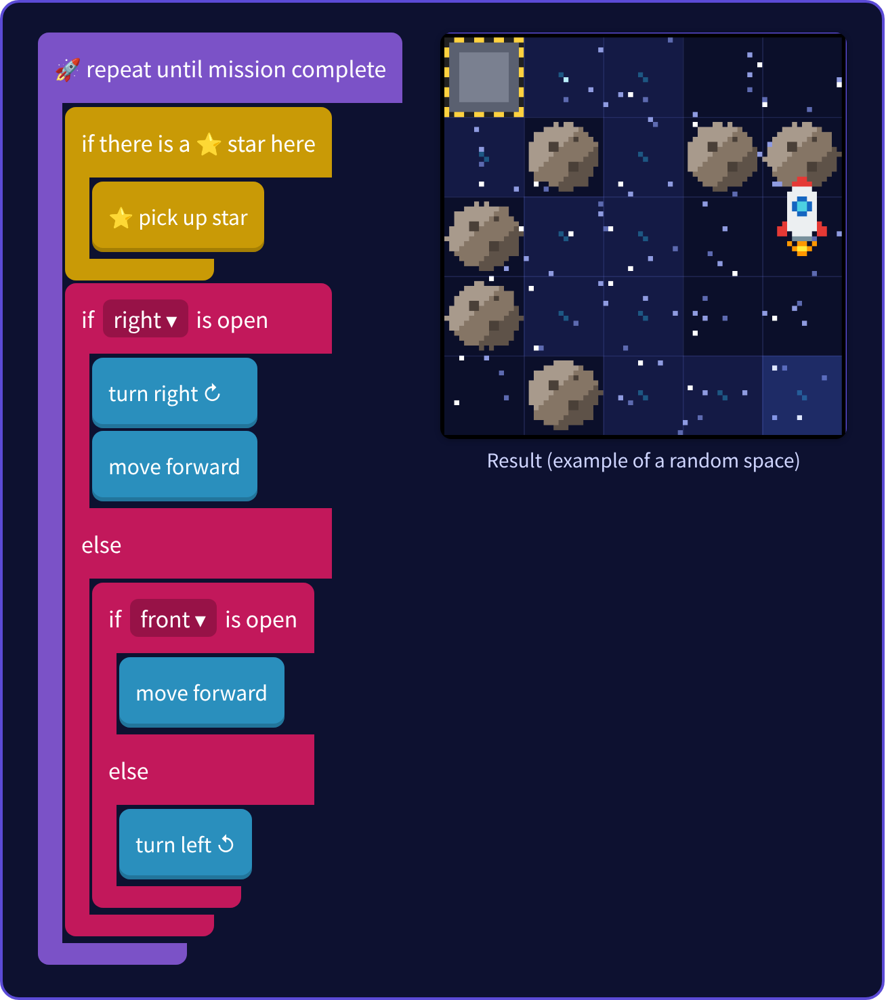
This is the right-hand rule from Maze Stage 8, plus "if there is a star here, pick it up".
Even if the astronaut passes the rocket before getting every star, it keeps following the walls. In the end it picks up all the stars and comes back to the rocket.
The random spaces used for the test always put the stars on squares that the right-hand rule walks over. We checked this answer on 1,000 random spaces, and it cleared every one.

With the Stage 6 program, the astronaut keeps going around in the same place and stops with "Too many moves".

### Free mode
The Stage 7 program clears any space.

---

# 🧱 Break & Build Quest

Use the pickaxe to **break** a stone block, and the block goes into your inventory. **Place** a block on water to make a bridge you can walk on. Reach the treasure chest to clear the stage.
- Dark, hard rock cannot be broken ("This rock is too hard to break!")
- Walking straight into stone or water is a mistake ("You bumped into…", "Splash!")
- Using "place" when you have no blocks is a mistake. The number of blocks you have is shown above the board ("Blocks you have")

| Stage | What students learn | Blocks in the answer |
|---|---|---|
| 1 Break and go | The "break" action | 5 |
| 2 Build a bridge | The steps: break → hold → place | 6 |
| 3 Break with a loop | Loops | 4 (target 4) |
| 4 A long bridge | A loop that uses up the blocks you have | 4 (target 4) |
| 5 If there is stone | Conditions (checking the front) | 4 (target 4) |
| 6 Stone and water | Two conditions; the block count going up and down | 6 (target 6) |
| 7 Spiral cave | Repeat until + three conditions | 8 (target 8) |

### Stage 1: Break and go
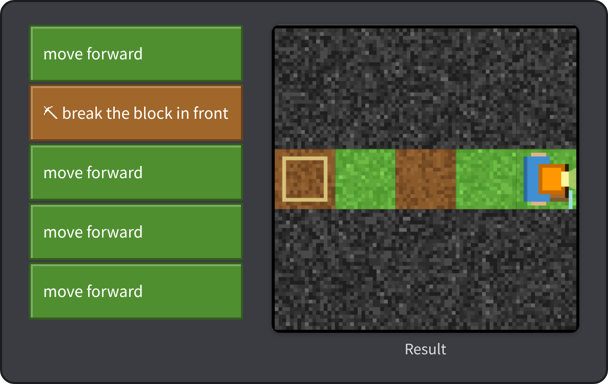

### Stage 2: Build a bridge

You start with no blocks. The key is noticing that you must break the stone first, then place the block on the water.

### Stage 3: Break with a loop
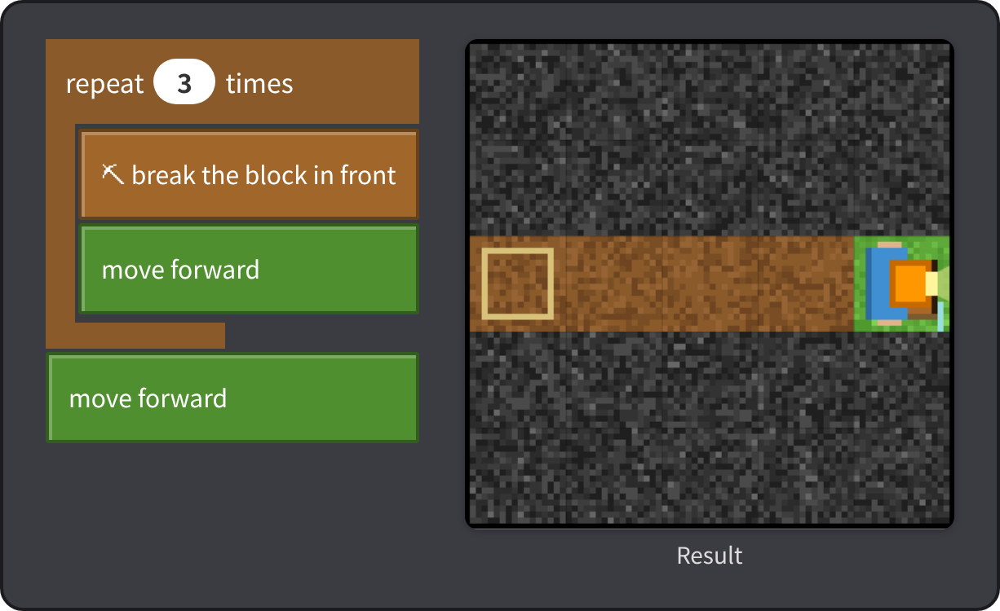

### Stage 4: A long bridge
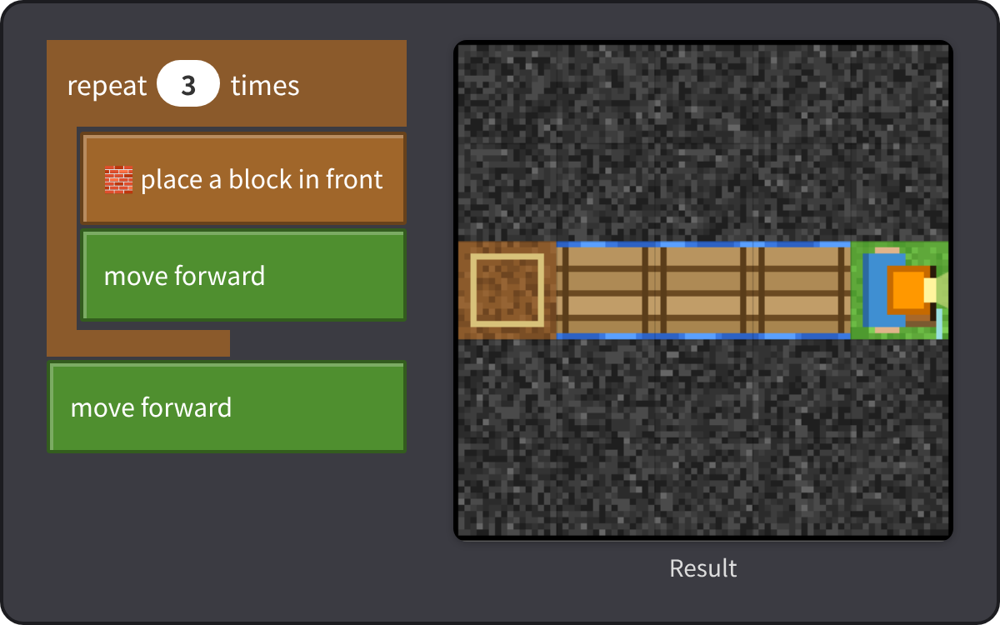
You start with 3 blocks. After placing 3, you have exactly 0 left.

### Stage 5: If there is stone
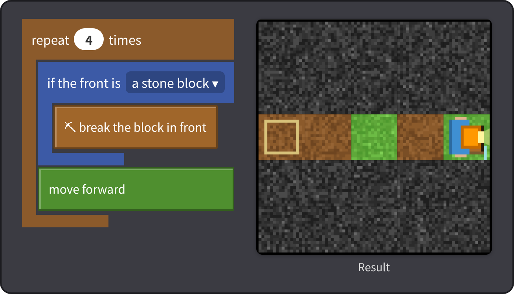
Without "if", repeating "break → move" fails on a square with no stone.

### Stage 6: Stone and water
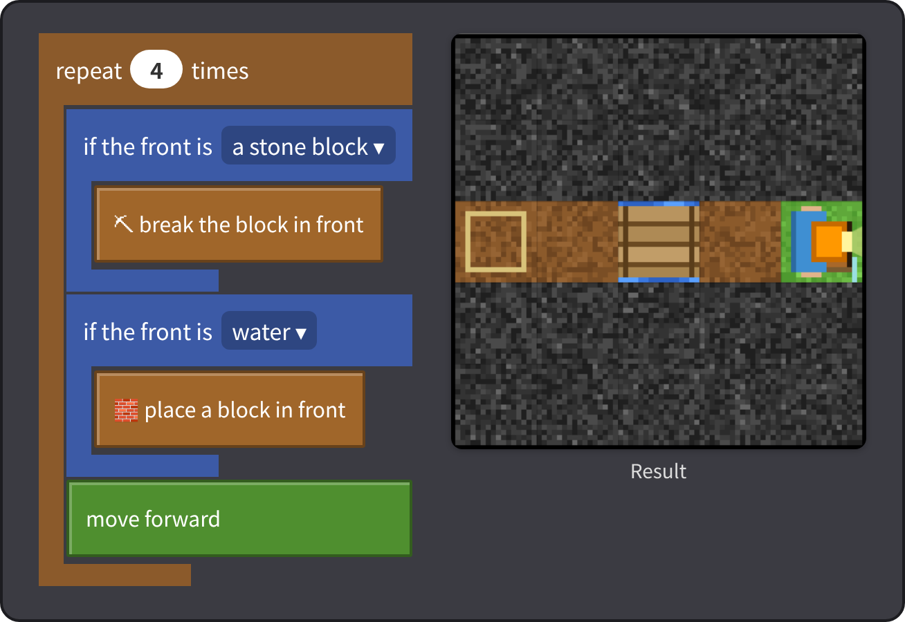
Breaking stone adds 1 block, and placing on water uses 1 (0 → 1 → 0 → 1).

### Stage 7: Spiral cave
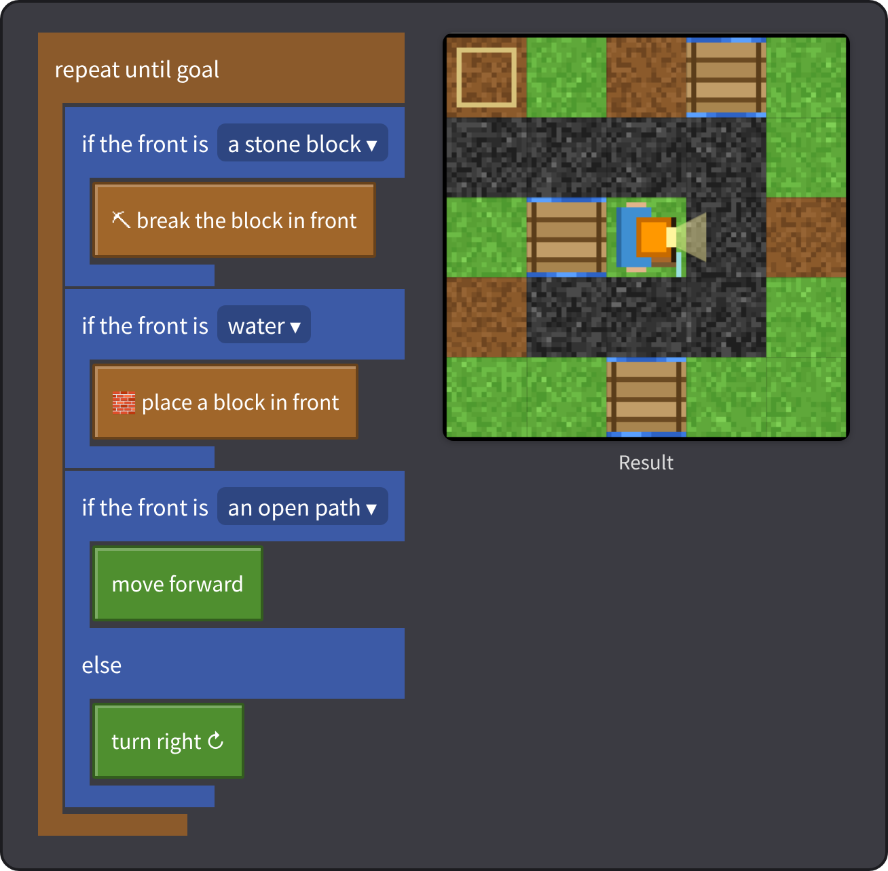
Each time through the loop: if the front is stone, break it; if it is water, place a bridge. Then move if the front is an open path; otherwise (hard rock or the outer wall) turn right.
With the Stage 6 program, the explorer cannot get around the corners and ends with "You didn't reach the goal."

### Free mode
Random worlds. You start with as many blocks as there are water squares (3), so every world can be cleared. There is no fixed answer, so the teacher-mode "Answer" button does not load one.

---

---

---

# 🐍 Python Drawing (python-draw.html)

Building these in block mode gives the same Python shown below. In Python mode, type the code as it is.

### ① Hexagon ★

**Key point**: Write numbers inside forward() and right(). The 2 lines inside for repeat 6 times.

```python
for i in range(6):
    forward(80)
    right(60)
```

### ② Star ★★

**Key point**: 5 turns make 720 degrees (twice around), so each turn is 720 ÷ 5 = 144.

```python
for i in range(5):
    forward(150)
    right(144)
```

### ③ Circle ★★

**Key point**: 36 turns of 10 degrees make 360. Many short lines look like a circle.

```python
for i in range(36):
    forward(10)
    right(10)
```

### ④ Window ★★★

**Key point**: The inner for is indented 8 spaces. After a square, right(90) inside the outer for.

```python
for i in range(4):
    for k in range(4):
        forward(60)
        right(90)
    right(90)
```

### ⑤ Flower ★★★

**Key point**: One circle is the inner for. The outer for turns 360 ÷ 6 = 60 degrees, 6 times.

```python
for i in range(6):
    for k in range(36):
        forward(5)
        right(10)
    right(60)
```

### ⑥ Square spiral ★★★★

**Key point**: range(10, 201, 10) gives 10, 20, … 200. The end is not included, so use 201. forward(i) gets longer each time.

```python
for i in range(10, 201, 10):
    forward(i)
    right(90)
```

### ⑦ Polygons in a row ★★★★

**Key point**: An n-sided shape turns 360 / n. range(3, 9) gives n = 3 to 8.

```python
for n in range(3, 9):
    for i in range(n):
        forward(50)
        right(360 / n)
```

### ⑧ Snowflake ★★★★★

**Key point**: One branch is 10 lines. It returns to the start, so right(60) moves to the next branch.

```python
for i in range(6):
    forward(80)
    back(30)
    left(45)
    forward(25)
    back(25)
    right(90)
    forward(25)
    back(25)
    left(45)
    back(50)
    right(60)
```

### ⑨ Star spiral ★★★★★

**Key point**: The length i * 4 grows by 4 each time, and turning 144 makes a star spiral.

```python
for i in range(1, 51):
    pen_color('random')
    forward(i * 4)
    right(144)
```

---

# 🐍 Python Maze (python.html)

Building these in block mode gives the same Python shown below. In Python mode, type the code as it is.

### Stage 1: Go straight

**Key point**: Python runs from the top line down. The “move forward” block = forward()

```python
forward()
forward()
forward()
forward()
```

### Stage 2: Let's turn

**Key point**: Turning does not move you. Don’t forget the “_” (underscore).

```python
forward()
forward()
turn_right()
forward()
forward()
```

### Stage 3: Repeat with for

**Key point**: Lines indented after “:” are inside the loop. Un-indent to leave the loop.

```python
for i in range(4):
    forward()
turn_right()
for i in range(4):
    forward()
```

### Stage 4: while and if

**Key point**: not means “is not”. while not at_goal() = “repeat while you are not at the goal”.

```python
while not at_goal():
    if is_open('front'):
        forward()
    else:
        turn_right()
```

### Stage 5: Three choices with elif

**Key point**: elif means “else if”. Putting an “if” block inside “else” becomes elif in Python.

```python
while not at_goal():
    if is_open('front'):
        forward()
    elif is_open('right'):
        turn_right()
    else:
        turn_left()
```

---

# 🐍 Python Space (python-space.html)

Building these in block mode gives the same Python shown below. In Python mode, type the code as it is.

### Stage 1: Pick up a star

**Key point**: pick_up() picks up the star on your square. Collect them all, then go to the rocket!

```python
forward()
forward()
pick_up()
forward()
forward()
```

### Stage 2: Turn and collect

**Key point**: turn_right() only changes direction. The order of turning and picking up matters.

```python
forward()
forward()
pick_up()
forward()
turn_right()
forward()
pick_up()
forward()
```

### Stage 3: Collect with for

**Key point**: To put 2 lines inside for, indent both by 4 spaces. The last forward() is not indented.

```python
for i in range(3):
    forward()
    pick_up()
forward()
```

### Stage 4: Star stairs

**Key point**: Put the whole 5-line set inside for. You reach the rocket during the 4th repeat, and it ends there.

```python
for i in range(4):
    forward()
    turn_right()
    forward()
    pick_up()
    turn_left()
```

### Stage 5: if has_star():

**Key point**: Lines inside if are indented one more level (8 spaces in total).

```python
for i in range(4):
    forward()
    if has_star():
        pick_up()
```

### Stage 6: while not mission_done():

**Key point**: mission_done() becomes True when you have every star and are at the rocket. not repeats “while it is not done yet”.

```python
while not mission_done():
    if has_star():
        pick_up()
    if is_open('front'):
        forward()
    else:
        turn_right()
```

---

# 🐍 Python Break & Build (python-craft.html)

Building these in block mode gives the same Python shown below. In Python mode, type the code as it is.

### Stage 1: Break and go

**Key point**: mine() breaks the stone in front, and it becomes a path.

```python
forward()
mine()
forward()
forward()
forward()
```

### Stage 2: Build a bridge

**Key point**: You start with no blocks. mine() to get one, then place() to build a bridge.

```python
mine()
forward()
place()
forward()
forward()
forward()
```

### Stage 3: Break with for

**Key point**: “mine() → forward()” 3 times. The last forward() is outside the for (not indented).

```python
for i in range(3):
    mine()
    forward()
forward()
```

### Stage 4: A long bridge

**Key point**: You have 3 blocks, so after 3 place() calls you have exactly 0.

```python
for i in range(3):
    place()
    forward()
forward()
```

### Stage 5: if front_is('stone'):

**Key point**: front_is('stone') is True if the front is stone. Indent one more level inside if.

```python
for i in range(4):
    if front_is('stone'):
        mine()
    forward()
```

### Stage 6: Stone and water with elif

**Key point**: Stone → mine(), else if water → place(). Breaking adds one and placing uses one (0 → 1 → 0 → 1).

```python
for i in range(4):
    if front_is('stone'):
        mine()
    elif front_is('water'):
        place()
    forward()
```

### Stage 7: Spiral cave

**Key point**: if, elif, elif and else split it into 4 cases. You check the front again on every loop.

```python
while not at_goal():
    if front_is('stone'):
        mine()
    elif front_is('water'):
        place()
    elif front_is('path'):
        forward()
    else:
        turn_right()
```
